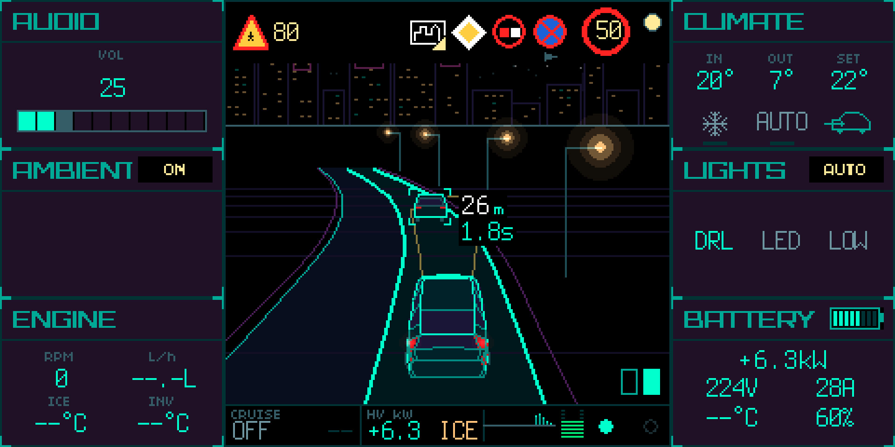
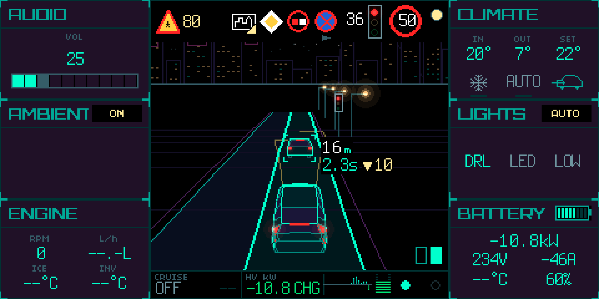
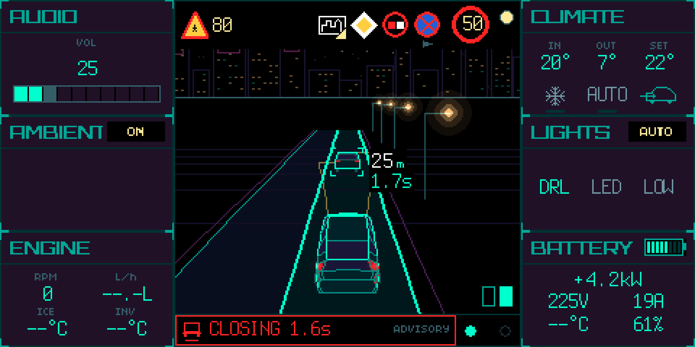
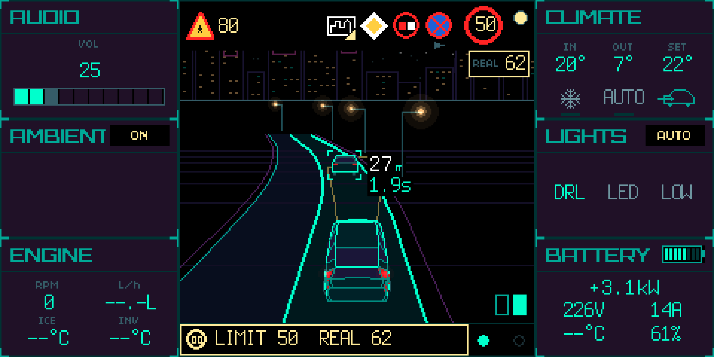
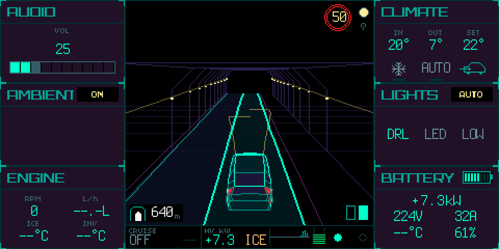
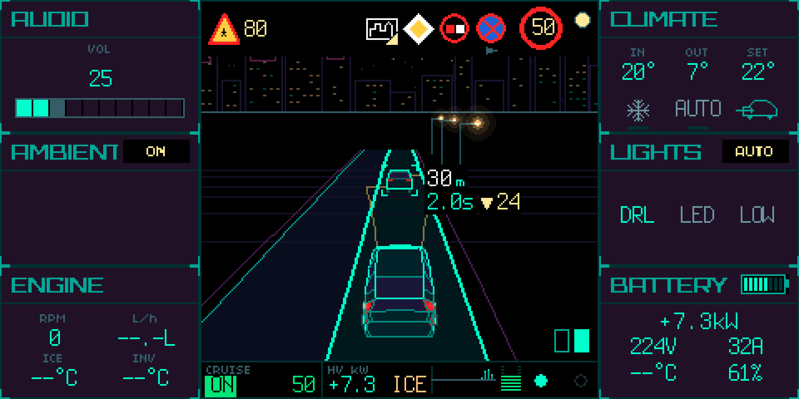
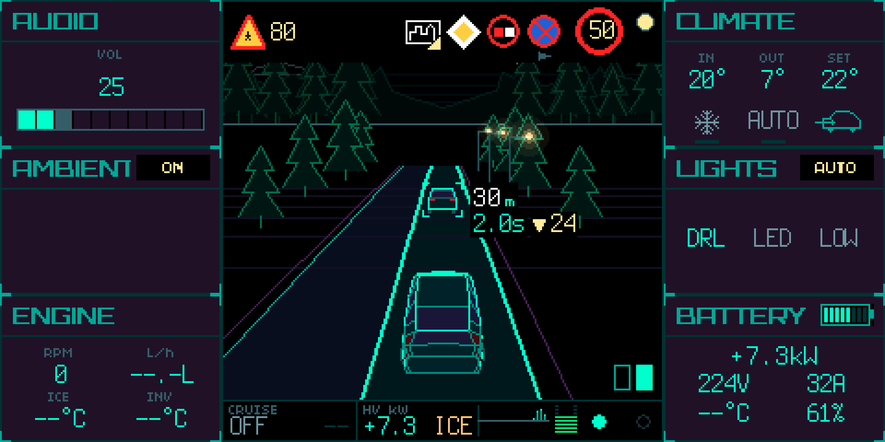
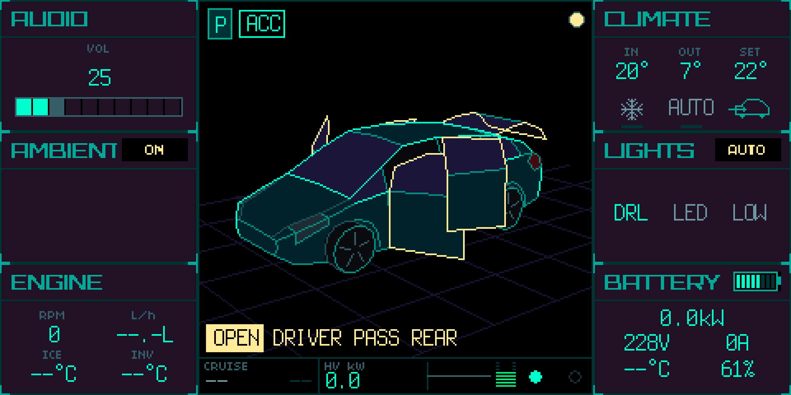
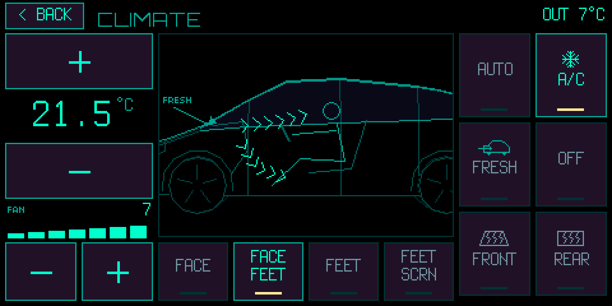
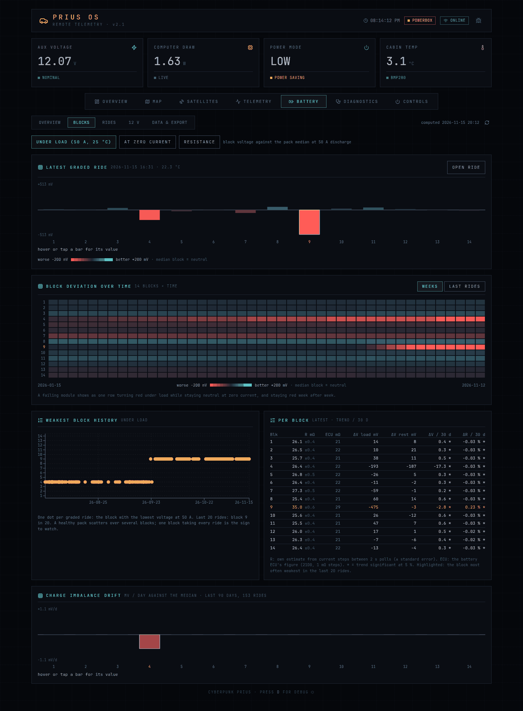

# CyberPunk Prius Gen 2 - Onboard Computer

Car computer for a Toyota Prius Gen 2 (NHW20): a headless backend on a POCO F1 phone, a pygame
UI on the car's own MFD (480×240), and RP2040 boards that bridge the car buses.

The system informs the driver and runs comfort functions. It does not steer, brake or accelerate.

- **Road scene on the factory screen**: a chase view of the car with lane lines, road edges, the
  lead vehicle with distance and time gap, traffic lights, warning signs and the speed limit, from
  the [roadsense](https://github.com/PiotrTopa/roadsense) camera perception service on the same phone.
- **Map layer**: next speed limit, tunnel exit distance, lane count and road shape beyond the
  camera's range, from roadsense's OpenStreetMap matching (verified on synthetic drives so far).
- **Driver alerts** in the status strip: speed limit with true speed, closing speed, headway, curve,
  ice risk, service and new fault codes. Every alert type ships in shadow mode (logged only) until
  it is switched on ([docs/FEATURES.md](docs/FEATURES.md)).
- **Car state from its own buses**: AVC-LAN (climate control, nav emulation), CAN (hybrid power,
  SOC, cruise state), BEAN body bus (lamps, doors), Toyota diagnostics over OBD/UDS.
- **Web dashboard** for statistics away from the car: HV battery block health over months,
  12 V battery, rides, diagnostics.

## Screenshots

Headless renders of the UI code in this repository with simulated vehicle and road data
(`python -m cyberpunk_computer.ui.scene.demo --shots DIR`,
`python -m cyberpunk_computer.ui.scene.alerts_demo --shots DIR`). The panel is 480×240; the images
are scaled 4×.

| | |
|---|---|
|  |  |
| Night drive: lanes and road edges, lead vehicle with distance and time gap, street lamps, signs in the top line | Red light 36 m ahead, lead vehicle at 16 m closing at 10 km/h; the strip shows regeneration (`CHG`) and the SOC gauge |
|  |  |
| Closing-speed advisory ([docs/ALERTS.md](docs/ALERTS.md)) | Speed-limit notice with the true speed (`REAL 62`) under the limit sign |
|  |  |
| Map layer in a tunnel: exit in 640 m, lamp rows | Factory cruise engaged with its set speed, shown only ([docs/CRUISE_CONTROL.md](docs/CRUISE_CONTROL.md)) |
|  |  |
| Scenery follows the camera's place, light and weather labels (here: forest, day) | Parked: the car model opens the doors and the hatch that are open |
|  |  |
| Climate screen over AVC-LAN: outlets, fan, A/C and intake drawn as air in the cabin | Dashboard, HV battery blocks (simulated 300-day history with one weak block, [docs/BATTERY_HEALTH.md](docs/BATTERY_HEALTH.md)) |

Main screen layout and its data contract: [docs/MFD_MAIN_SCREEN.md](docs/MFD_MAIN_SCREEN.md).

## System

```
POCO F1 (postmarketOS, always on)
  prius-backend   python -m cyberpunk_computer.backend
                  virtual twin (store + rules), metrics SQLite, diagnostics engine
                  REST + WebSocket :8080 (serves dashboard/dist at /), ZMQ PUB :8081 / REP :8082
  roadsense       separate repos, systemd roadsense.target, ACC only; API :8090
   │
   ├─ USB hub ─ Gateway (RP2040, NDJSON over CDC): AVC-LAN, solicited CAN (OBD/UDS),
   │            RS485 satellites (ids 100-199)
   ├─ USB hub ─ Powerbox (RP2040, NDJSON over CDC): relays, INA219, ignition, BEAN RX (ids 200-203)
   ├─ USB hub ─ comma.ai panda: broadcast CAN listener, SAFETY_SILENT
   ├─ USB gadget usb0 ─ MFD Pi Zero v1.3: python -m cyberpunk_computer.frontend → DPI/VGA666 → MFD
   └─ BLE / Wi-Fi AP ─ satellites (BLE ids 300-399, Wi-Fi ids 400-499)
```

| Part | Where it is documented |
|---|---|
| POCO F1: OS, networking, power profiles, provisioning | [POCO/README.md](POCO/README.md) |
| Powerbox firmware (relays, INA219, ignition, BEAN RX) | [powerbox/README.md](powerbox/README.md) |
| Backend / frontend processes, transports, input model | [docs/ARCHITECTURE.md](docs/ARCHITECTURE.md) |
| State store, actions, rules, IO ports, device ids | [docs/VIRTUAL_TWIN_ARCHITECTURE.md](docs/VIRTUAL_TWIN_ARCHITECTURE.md) |
| Gateway NDJSON protocol as used by the backend | [docs/PROTOCOL.md](docs/PROTOCOL.md) |
| Deployment (backend to the POCO, frontend to the Pi) | [docs/DEPLOYMENT.md](docs/DEPLOYMENT.md) |
| Satellites (RS485 / BLE / Wi-Fi, keychain) | [docs/SATELLITES.md](docs/SATELLITES.md), [docs/SATELLITE_POWER.md](docs/SATELLITE_POWER.md), [docs/VFD_SATELLITE_PROTOCOL.md](docs/VFD_SATELLITE_PROTOCOL.md) |
| Thermal model and fan policy of the POCO | [docs/THERMAL_MODEL.md](docs/THERMAL_MODEL.md) |

The gateway firmware, the Pi image files and the per-day capture logs live in the sibling
repository `cyberpunk-prius-gateway` (`gateway-rp2350/`, `raspberry_pi_config/`,
`captures/<date>/CAPTURES.md`). The AVC-LAN protocol notes (framing, units, nav emulation
dialogue, transceiver, standalone RP2040 firmware) are published separately as
[prius-gen2-avclan](https://github.com/PiotrTopa/prius-gen2-avclan).

## Car buses and peripherals

| Document | Content |
|---|---|
| [docs/prius_can.md](docs/prius_can.md) | CAN broadcast IDs and diagnostic PIDs with scaling |
| [docs/BEAN_PROTOCOL.md](docs/BEAN_PROTOCOL.md), [docs/BEAN_SIGNALS.md](docs/BEAN_SIGNALS.md) | BEAN body bus: protocol and tap points; this car's signal map, CAN mirror, actuation, open gaps |
| [docs/CRUISE_CONTROL.md](docs/CRUISE_CONTROL.md) | Factory cruise control: signals, latencies, state machine, tap step, stalk switch bits, open measurements for a stalk interposer |
| [docs/FINDINGS_LOG.md](docs/FINDINGS_LOG.md) | Dated one-line index of findings about the car and its buses, with links |
| [docs/AVC_BACKEND.md](docs/AVC_BACKEND.md) | AVC-LAN decoding, nav emulation, climate remote |
| [docs/TOYOTA_DIAGNOSTICS.md](docs/TOYOTA_DIAGNOSTICS.md) | All-ECU diagnostics engine, DTC dictionary, safety rules |
| [docs/MFD_VIDEO_TIMINGS.md](docs/MFD_VIDEO_TIMINGS.md) | MFD RGBS input: DPI timings, VGA666, sync wiring |
| [docs/HEADUNIT_INTEGRATION.md](docs/HEADUNIT_INTEGRATION.md) | Android head unit (AC8227L): access, MCU protocol, wheel keys, volume chain |
| [docs/DASHCAM_70MAI.md](docs/DASHCAM_70MAI.md) | 70mai dashcam stream, first-drive light data, auto-light rule |
| [docs/VISION_ROADMAP.md](docs/VISION_ROADMAP.md) | In-repo vision package: lights, environment, detector slot, map speed limit |
| [docs/VISION_ENVIRONMENT_MODEL_2026-10-19.md](docs/VISION_ENVIRONMENT_MODEL_2026-10-19.md), [docs/VISION_DETECTOR_EXPERIMENT_2026-10-19.md](docs/VISION_DETECTOR_EXPERIMENT_2026-10-19.md) | Experiment reports with their data in `docs/data/` and `docs/img/` |

## Running

Python 3.11+; `pip install -r requirements.txt` (pygame, pyserial, fastapi/uvicorn, pyzmq,
websocket-client). The backend on the POCO uses `cyberpunk_computer/backend/requirements-backend.txt`.

```bash
# headless backend (on the POCO it runs as prius-backend.service)
python -m cyberpunk_computer.backend --gateway-port /dev/ttyACM0
python -m cyberpunk_computer.backend --replay FILE          # replay a recording, no hardware

# UI against a running backend (on the MFD Pi it runs as mfd.service)
python -m cyberpunk_computer.frontend --host <backend-ip> --dev --scale 2

# standalone UI with a local virtual twin (no backend): file replay or a directly attached gateway
python -m cyberpunk_computer --replay assets/data/full.ndjson --dev --scale 2
python -m cyberpunk_computer --dev --port /dev/ttyACM0
```

Tests: `SDL_VIDEODRIVER=dummy python -m pytest tests/`. Dashboard (React/Vite web UI served by the
backend): [dashboard/README.md](dashboard/README.md).

### Controls

| Key (dev) | Event |
|---|---|
| ← / → , mouse wheel | rotate left / right |
| Enter | light press |
| Space | strong press |
| Escape | back |

Mouse (dev) and the MFD touch panel (production) drive one gesture recogniser
(`cyberpunk_computer/ui/pointer.py`) that maps onto the same events:

| Gesture | Effect |
|---|---|
| Tap a panel / button / list row | focus + light press |
| Long press (≥ 600 ms) | strong press (detail screen; DTC clear confirm) |
| Drag the volume bar | set volume directly |
| While editing: tap `+` / `−` side, or drag sideways | rotate right / left |
| Swipe left / right (dashboard centre, paged screens) | next / previous page |
| `< BACK` chip / footer `BACK` button | back |

MFD hardware buttons: `menu` → home, `map` → dynamics page, `dest` → engine/diagnostics menu,
`maintenance` → DTC screen, `calendar`/`language` → no-op (`cyberpunk_computer/ui/hw_buttons.py`).
Touch contract and pointer rules: [docs/ARCHITECTURE.md](docs/ARCHITECTURE.md#2-input-abstraction).

## Repository layout

```
cyberpunk_computer/
  backend/     headless service: engine loop, ZMQ server, MFD/roadsense/port power, satellites, fan policy
  frontend/    remote UI client (RemoteTwin over ZMQ)
  api/         FastAPI REST + WebSocket, camera preview, roadsense proxy
  io/          virtual-twin IO: ports, ingress/egress, serial, panda, powerbox, satellite transports, dashcam ingest
  state/       store, AppState, actions, rules
  comm/        protocol decoders: avc/, CAN, BEAN, solicited PIDs, subscription groups
  diag/        all-ECU diagnostics engine + DTC dictionary
  vision/      dashcam lights / environment model, detector slot, map speed limit
  metrics/     SQLite metrics sink
  core/ ui/ input/   pygame application, screens, widgets, input
dashboard/     web dashboard (React, Vite)
POCO/          phone OS overlay, provisioning, docs
powerbox/      powerbox MicroPython firmware
satellites/, vfd_satellite/   satellite firmware / apps
deployment/    MFD Pi units and helper scripts (see docs/DEPLOYMENT.md)
tools/, scripts/   analysis and bench tools
assets/        fonts, sample recordings
docs/          reference documentation, experiment data (docs/data/, docs/img/)
```

## License

MIT, see [LICENSE](LICENSE).
