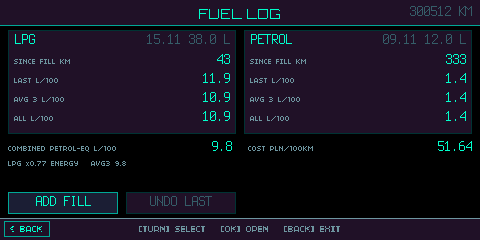
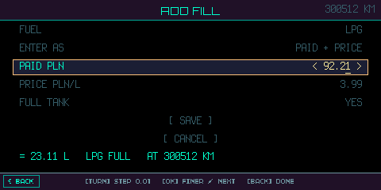

# Fuelling log

The driver registers fill-ups (LPG or petrol); the backend stores each with its own odometer and
what the car knows at that moment, and computes distance, consumption and cost figures that account
for both fuels. Code: `cyberpunk_computer/fuel_log/` (backend), `ui/screens/fuel_log_screen.py`
(MFD). Tests: `tests/test_fuel_log.py`, `tests/test_fuel_log_screen.py` (`.venv-fe`).

## 1. Storage

`fuel_log.db` (SQLite, WAL) next to the metrics database (`cfg.db_path`; override
`BACKEND_FUEL_LOG_DB`). Wired by `backend/service.py` for live data only (not in replay).

| Column | Meaning |
|---|---|
| `ts` | time of the fill, epoch s (may be back-dated) |
| `fuel` | `lpg` or `petrol` |
| `litres` | litres added (computed as `total / price_per_l` when the amount paid was entered) |
| `price_per_l`, `total` | optional; PLN per litre and amount paid |
| `full` | tank filled to the cut-off (default yes) |
| `odometer_km`, `odometer_source` | the backend's odometer at the fill; `live`, `given` or `metrics_speed` (section 2) |
| `est_total_l` | the cumulative estimator counter at the fill (section 3.4); none for a back-dated entry |
| `car_json` | snapshot when the entry is made at the pump: `odometer_km`, `distance_total_km`, `fuel_level` (petrol gauge), `active_fuel` (+ `active_fuel_detected`), `fuel_basis`, `trip_fuel_consumed_l`, `drive_distance_km`, `meter_trip_km`, `meter_trip_fuel_l`, `meter_avg_consumption_l100km`; none for a back-dated entry |
| `deleted` | set by undo (the row is kept) |

## 2. Odometer

The meter's odometer (BEAN `52:3F`) is frozen at 299,999 km on this car
([BEAN_SIGNALS.md](BEAN_SIGNALS.md) §4). The log always uses the backend's own odometer
`vehicle.odometer_km` (`odometer.json` next to the metrics database, integrated from the 0x230
distance counter; [FINDINGS_LOG.md](FINDINGS_LOG.md) 2026-11-17). Consequences:

* the figures cover only distance the backend saw. If the backend is down while the car drives, the
  odometer misses those km and the l/100 km of that window reads high;
* the log never shows the meter's reading; compare with the car only through differences.

Where the odometer of an entry comes from:

| Case | Source |
|---|---|
| `odometer_km` given | `given` |
| entry made now (ts within 5 min) | `live`: `vehicle.odometer_km` (refused while it is unknown) |
| back-dated `ts`, no `odometer_km` | `metrics_speed`: live odometer minus the km driven since `ts`, integrated from the 1 Hz `speed` metric (raw samples, kept 2 days; gaps over 5 s count as standstill). Refused when the raw record does not reach back to `ts` |

## 3. Figures (`fuel_log/model.py`)

### 3.1 Full-to-full per fuel

For each fuel separately, fills are ordered by odometer. Between two consecutive full fills of the
same fuel (a segment) the litres added after the first, up to and including the second, are what
was burnt of that fuel over the odometer distance between them. Partial fills are added to the next
full fill of that fuel. Fills before the first full fill of a fuel cannot be attributed
(`unattributed_l`); partial fills after the last full fill wait (`pending_l`).

```
l_per_100km(segment) = litres / distance_km * 100
```

The car burns both fuels on the same kilometres (cold start and warm-up on petrol, then LPG), so
**every per-fuel figure is litres of that fuel per 100 km of total driving**, not per km driven on
that fuel (which nothing measures). A segment under 20 km (`MIN_SEGMENT_KM`) gets no own l/100 km;
its litres and km still count in the sums.

### 3.2 Windows and averages

| Figure | Window |
|---|---|
| `last` | the last segment of the fuel |
| `rolling` | the last N segments (`ROLLING_N` = 3) |
| `overall` | the fuel's whole window: from its first to its last full fill |

Averages are sums: `sum(litres) / sum(km) * 100`, never a mean of ratios. Price of a window: the
litre-weighted mean of the fills with a price (`price_coverage` in a segment says which share of its
litres had one); `cost_per_100km = l_per_100km * price_per_l`.

Each fuel is measured over its own window. A strict common window is not measurable in general,
because the litres of a fuel are known only at its own full fills; with LPG filled every few hundred
km and petrol every few thousand, the petrol window is the longer one. `combined.overlap_km` is the
overlap of the two windows.

### 3.3 Combined figure

Because the per-fuel rates are per total km they add:

```
petrol_eq_l_per_100km = petrol_l_per_100km + k * lpg_l_per_100km
cost_per_100km        = petrol_l_per_100km * petrol_price + lpg_l_per_100km * lpg_price
```

`k = LPG_TO_PETROL_ENERGY = 0.77` (volumetric energy ratio; autogas ~46 MJ/kg x ~0.54 kg/l ≈
24.8 MJ/l against petrol E5 ≈ 32.2 MJ/l; the literature range is 0.74..0.80 with the propane/butane
mix and season). Override: environment `PRIUS_LPG_PETROL_ENERGY` (0.5..1.0).

While only one fuel has a segment, the combined value is that fuel's contribution alone and marked
`lower_bound` (the other fuel contributes >= 0); the MFD shows it as `>=`. Combined figures exist for
`last`, `rolling` and `overall` (pairing the same kind of window of the two fuels).

### 3.4 Calibration hint against the backend's estimate

The backend estimates fuel from CAN 0x520 x rpm (`state/fuel_model.py`); its litres are
petrol-equivalent for both fuels (the LPG controller drives its injectors from the petrol pulses).
The service integrates `vehicle.trip_fuel_consumed` (reset at IG-ON and at backend start) into a
monotonic counter `est_total_l` (persisted every 30 s in the `kv` table) and stores it with each
entry made at the pump. For a segment `est_l` = counter difference; a window's
`est_l_per_100km` = sum(est_l) / sum(km) over the segments that have both ends. The combined figure
carries `measured_over_est` = `petrol_eq_l_per_100km` / estimate (taken over the window, LPG or
petrol, with the most estimated km). It is a hint for `PRIUS_FUEL_FLOW_K`; the estimator is not
changed. It is only meaningful when `k` matches what the LPG controller really injects, and not for
a lower-bound combined figure.

### 3.5 Since the last fill

Per fuel: `since_last.km` (odometer now minus the last fill of that fuel), `since_last.km_full`
(since its last full fill), `since_last.est_l` (estimator litres since the last fill).

## 4. Commands and state

REST `POST /api/v1/commands/<name>` with a JSON body, or ZMQ (same command table,
`api/commands.py` -> `fuel_log/commands.py`). Results are asynchronous: `fuel_log.last_command`
= `{op, ok, error, ts, id, odometer_km, odometer_source, litres, warnings}` (warnings: odometer
order disagrees with time order against another fill).

| Command | Parameters |
|---|---|
| `fuel_log_add` | `fuel` (lpg/petrol); `litres`, or `total` + `price_per_l` (litres = total / price, rounded to 0.01; all three must agree within 1 %); `price_per_l` optional with litres; `full` (default true); `ts` (epoch s or ISO; no offset = Europe/Warsaw; default now); `odometer_km` (default section 2); `note` |
| `fuel_log_undo` | `id` optional (must be the last entered fill); removes the most recently entered fill |
| `fuel_log_edit_last` | any `fuel_log_add` field; changes the most recently entered fill. A new `total` or `price_per_l` without `litres` recomputes litres; new `litres` without `total` recomputes the total from the price |

Examples:

```
curl -X POST localhost:8080/api/v1/commands/fuel_log_add -H 'content-type: application/json' \
     -d '{"fuel": "lpg", "total": 92.21, "price_per_l": 3.99}'
curl -X POST .../fuel_log_add -d '{"fuel": "lpg", "total": 92.21, "price_per_l": 3.99, "full": true,
     "ts": "2026-11-17T16:30:00+01:00", "odometer_km": 300012.7}'
curl -X POST .../fuel_log_add -d '{"fuel": "petrol", "litres": 31.4, "full": false}'
curl -X POST .../fuel_log_edit_last -d '{"price_per_l": 4.09}'
curl -X POST .../fuel_log_undo -d '{}'
```

State section `fuel_log` (in `GET /api/v1/state` and the stream): `enabled`, `count`, `entries`
(last 12, newest first, with the `car` snapshot), `figures` (section 3: `lpg` / `petrol` with
`last_fill`, `since_last`, `last`, `rolling`, `overall`, `segments` (last 10), `pending_l`,
`unattributed_l`; `combined.{last,rolling,overall}`; `energy_factor`, `rolling_n`,
`est_total_l`), `defaults` (per fuel: last `price_per_l`, `litres`, `total`), `last_command`,
`updated_at`. Republished after every command and every 30 s while the odometer moves.

## 5. MFD

ENGINE / DIAGNOSTICS menu (light press on the ENGINE box) -> `FUEL LOG` (first row; the menu rows
are 23 px now so seven fit).

| | |
|---|---|
|  |  |
| Summary (synthetic fills) | Add fill: amount paid, last digit being edited |

Summary: one box per fuel (last fill date and litres, `P` = partial; km since the last fill; last,
rolling and overall l/100 km), the combined petrol-equivalent l/100 km and the cost per 100 km
(`>=` when lower bound), a caption line with `k`, the rolling combined value and the estimate ratio;
keys `ADD FILL` and `UNDO LAST` (turn selects, OK opens; undo asks `UNDO LAST?` and needs a second
OK, a turn or BACK cancels); the result of the last command beside the keys.

Add fill: a list in the settings style. `FUEL` (OK toggles; loads that fuel's defaults), `ENTER AS`
(`PAID + PRICE`, the default, or `LITRES`), `PAID PLN` / `LITRES`, `PRICE PLN/L` (optional in litres
mode), `FULL TANK` (default yes), `SAVE`, `CANCEL`. OK on a number edits it digit by digit: the turn
changes the underlined digit (amount 100 / 10 / 1 / 0.1 / 0.01, litres 10 / 1 / 0.1, price 1 / 0.1 /
0.01), OK moves to the next finer digit and after the last one to the next row. Defaults: the last
price, amount and litres of the fuel. The line under the list shows the computed litres (or amount)
and the odometer. Touch: rows as in the other settings screens, the two keys, the `< BACK` chip.
Without a backend log the header says `NO LOG`.

## 6. Caveats

* Figures depend on the driver filling to the same cut-off; a full fill that was not really full
  moves litres between two segments (their sum stays right).
* Odometer coverage: section 2.
* The combined figure pairs per-fuel windows that differ; with steady driving that is harmless,
  across seasons it is not (winter: more petrol, longer warm-up).
* `k` is a mean value; it changes with the LPG mix.
* Price and cost: PLN assumed, nothing converts currencies.
* Back-dated entries have no car snapshot and no estimator counter, so the first segment ending or
  starting at one has no estimate.
