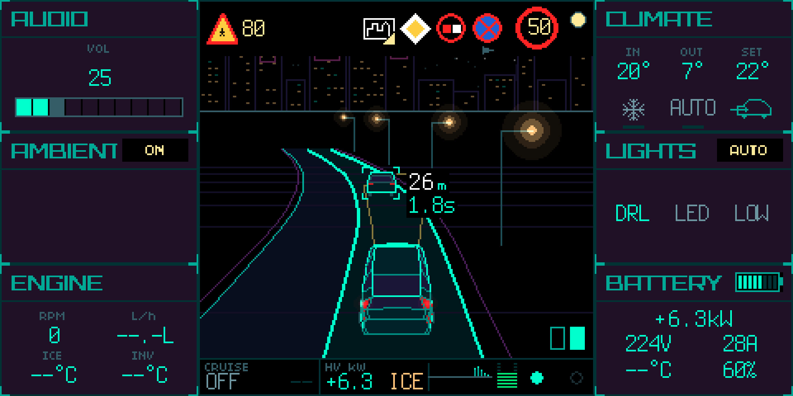
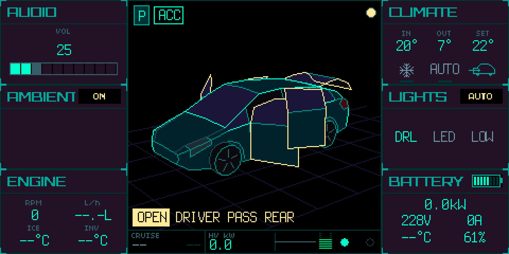
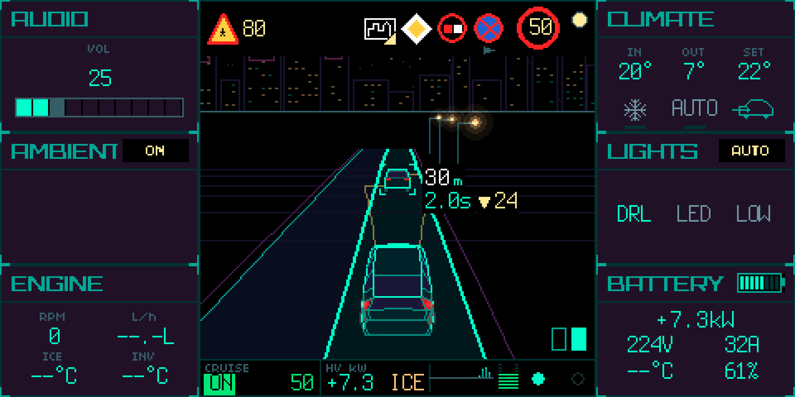
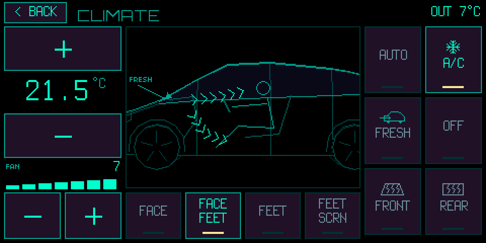
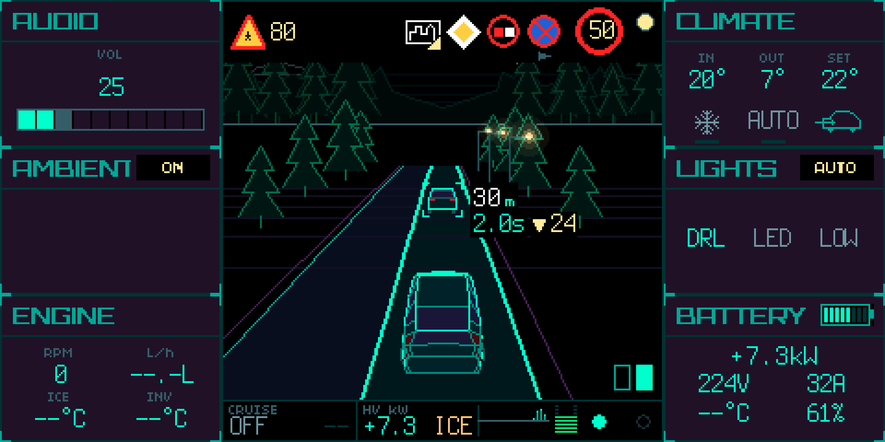
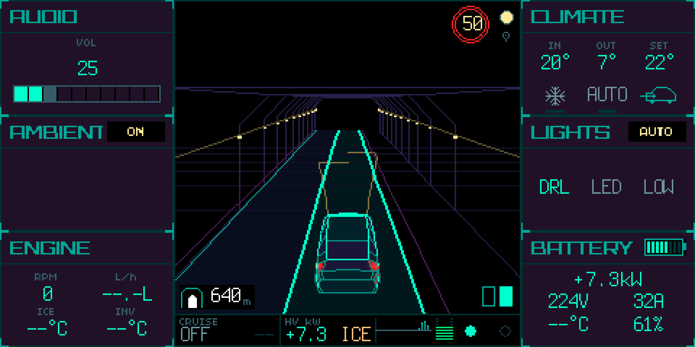
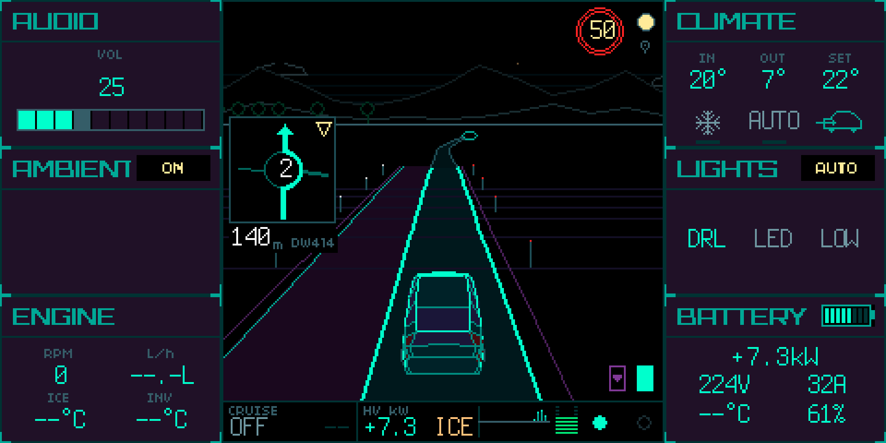
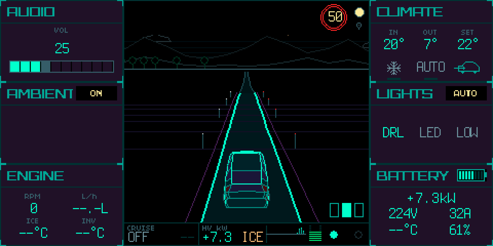
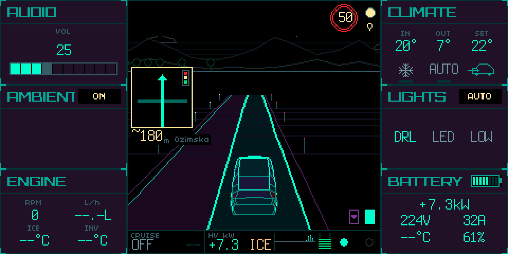

# MFD main screen: scene and status strip

The centre column of the main screen (`ui/screens/main_screen.py`, page 1) shows the car when it is
parked and the road when it drives. Code: `cyberpunk_computer/ui/scene/`. Tests:
`tests/test_mfd_scene.py`. Demo: `python -m cyberpunk_computer.ui.scene.demo`.

| | |
|---|---|
|  |  |
| Driving: road, lead vehicle with distance and time gap, signs in the top line, status strip | Parked: the car with the open doors and hatch |

Headless renders of the demo timeline (`--shots DIR`), scaled 4×.

## 1. Hardware it is built for

| Fact | Value | Consequence |
|---|---|---|
| Panel | 480 x 240, 60 Hz progressive, analog RGBS through a VGA666 resistor DAC (`docs/MFD_VIDEO_TIMINGS.md`) | everything is laid out in native pixels |
| Colour | RGB666 (64 levels per channel), per-channel skew on edges | no anti-aliasing: text, lines and polygons are 1-bit; the only soft pixels are stepped lamp halos |
| Fonts | Terminus from 14 px (even sizes), 04B03 below (`ui/fonts.py`) | read-outs are Terminus 14/16/28, labels 04B03 8 px; sign pictograms are drawn, not typeset |
| CPU | Pi Zero 1.3, one ARMv6 core; a full frame (all panels + push to the framebuffer) costs about 20 ms | frames are rendered only when something changed (section 10); the scene is a cached surface, re-drawn at most 10 times a second and only while it changes |
| Start-up | UI start time is a known problem | `ui/scene` is imported and built after the first frame is on the glass (`MainScreen.scene_page`), not at start-up |

## 2. Layout (centre column, x 120..359)

```
y   0 ┌────────────────────────────┐
      │ scene, 238 x 216           │  parked: the car   driving: the road
y 217 ├──────────┬──────────┬──────┤
      │ CRUISE   │ HV power │ dots │  strip 194 x 21 + page dots 44 px
y 240 └──────────┴──────────┴──────┘
```

The side panels (AUDIO, AMBIENT, ENGINE, CLIMATE, LIGHTS, BATTERY) and page 2 are unchanged; the
strip is shown on every page. The link LED stays in the top-right corner of the scene.

Backend link: when no envelope (state, event or the backend's idle heartbeat) has arrived for
more than 4 s (`MainScreen.LINK_LOST_S`; state comes at about 1 Hz), `NO LINK` appears in
Terminus 14 amber left of the link LED and the LED turns red, on every page; the picture behind
it is the last one received. It clears with the next envelope. Before 2026-11-17 the LED showed
only the gateway state from the last snapshot, so a dead link left a live-looking picture. The
client heals the link itself (ZMTP heartbeats, then a socket rebuild after 10 s of silence,
`frontend/client.py`); the backend restarts `mfd.service` as a last resort when the awake board
holds no ZMQ connection for 180 s (`backend/mfd_power.py`, `BACKEND_MFD_FRONTEND_RESTART_S`).

The look is "quiet road": the road and the lead vehicle dominate, the scenery is a faint band over
the horizon, and secondary information appears when it matters. How much is shown is set in one
place, `ui/scene/tuning.py` (section 12).

Scene HUD while driving (all on the scene surface):

| Place | Content |
|---|---|
| top line, y 3..29 | the signs. From the left: warning signs ahead, nearest first, each followed by the expected distance in metres (default: up to three, within 400 m). Right-aligned against the limit: the rules in effect (default: up to six; as many as fit, `+n` for the rest); a small pointer under a rule that binds one side of the road. Then the ego traffic light as a three-lamp signal with its distance in metres, the speed-limit sign and the link LED |
| speed | not shown in the scene (the car has a speedometer). `show_speed` brings back speed (Terminus 28, `display_speed_kmh`), `km/h`, gear and the green `SET nn` chip top-left; the signs then move to a row at y 33..52 |
| bottom-right | lane boxes: one per lane seen, the own lane lit (only when a neighbouring lane is seen; section 6.4) |
| bottom-left | chip `HIGH` while the high beam is on (all lamps with `lamp_chips = all`), above it the perception status (nothing when live) |
| from the map (section 6.5; only with a usable map) | top-left, before the warnings: the next speed limit as a dashed ring with its distance; under the link LED a 5 x 7 pin (amber on dead reckoning); beyond the camera's 100 m the road up to the horizon; bottom-right the lane boxes from the map's lane count; bottom-left the tunnel exit distance |
| on the road | lead vehicle with target brackets and its distance; under it the time gap when shorter than 2.5 s and the closing/opening speed in km/h with an arrow from 5 km/h |

Rules and warnings stay for 4 s after the feed stops carrying them (`sign_hold_s`; the feed drops
its `signs` key 3 s after roadsense's last `rules` message), never while roadsense is off.

Status strip (`scene/powerbox.py::StatusStrip`, 194 x 21):

| x | Content |
|---|---|
| 0..71 | **Cruise slot.** Caption `CRUISE`; the state in Terminus 14 (`--` nothing known, `OFF` main switch off, `READY` main switch on, `ON` engaged, green); the set speed in Terminus 14 (`--` when unknown; the memory speed dim with a bar over it when only that is known); three gap bars at x 64..72 drawn only when a gap setting exists |
| 76..138 | Caption `HV kW`; the HV battery power in Terminus 14 (green while charging); `ICE` / `CHG` / `EV` in Terminus 14 |
| 140..176 | 18 history bars (1 px + 1 px gap, discharge up in cyan, charge down in green, +-25 kW, time base = `display.power_chart_time_base`, 60 s by default) |
| 180..191 | SOC as the 8 segments of the factory gauge |

The strip is the stopgap for the power read-out until the VFD satellite shows it; the BATTERY panel
keeps the numbers.



*Cruise slot `ON 50`, HV power with `ICE`, history bars and the SOC segments.*

CLIMATE box: the three indicators are LED keys (`ui/widgets/led_keys.py`): an original 1-bit
pictogram with a dash under it that is amber when on. A/C = snowflake, AUTO = the word (as on the
car's key), intake = a car with the air looping inside and the dash lit for recirculation, a car
with an arrow entering at the nose and no dash for fresh air.

LIGHTS screen (`ui/screens/lights_screen.py`, opened by a tap on the LIGHTS box): left the car model
lit from the real lamp state (`POS` / `LOW` / `HIGH` / `FOG` chips under it) and what the camera
recommends (`vision.lights_recommended`, reason, confidence); right the stored settings as tiles:
mode (three 74 x 44 tiles), BiLED (three 74 x 40 tiles, brightness keys 44 x 36 in steps of 10 with
PWM), DRL (236 x 40). One tap per setting; the encoder path is unchanged. The settings are persisted
values only (no command exists for them), and each control panel says `STORED ONLY`.

CLIMATE screen (`ui/screens/climate_screen.py`, opened by a tap on the CLIMATE box; data and
commands through `state/climate_model.py::ClimateController`, AVC-LAN only): a cabin view.

| Area | Content | Touch target |
|---|---|---|
| header | `< BACK` key, title, `NO AVC` / `STALE` flag in amber, outside temperature (inside temperature only if a value exists; it is not on the bus) | BACK 62 x 21 (hit zone 74 x 27) |
| left | set temperature in Terminus 32 (0.5 degree steps; `OFF` / `--` as the model says) between a `+` and a `-` key; fan level text and seven growing segments over a `-` and a `+` key | temperature keys 116 x 44, fan keys 56 x 46 |
| centre | the NHW20 in side view as an X-ray (nose left, cropped to the cabin): seat, occupant, dashboard. Air streams as moving chevrons for exactly the outlets of the reported direction (`face`, `face_foot`, `foot`, `windscreen_foot`, `defrost`), more and faster with the fan level, bright cyan with A/C on and warm without; the intake as an arrow entering at the cowl (`FRESH`) or an amber loop in the cabin (`RECIRC`); amber heat marks on the windscreen (front defrost) and at the rear glass (rear defogger). `SYSTEM OFF` / `NO CLIMATE DATA` instead of streams | (picture only) |
| under the cabin | the four outlets as tiles: FACE, FACE FEET, FEET, FEET SCRN | 55 x 46 each |
| right | AUTO, A/C, intake (FRESH / RECIRC), OFF, FRONT (defrost), REAR (defogger) as single-tap tiles with an amber LED dash when on | 56 x 66 each |



Behaviour: everything is drawn from `ClimateController.view()` each frame. AUTO tapped while in AUTO
leaves it through the controller's "manual" mode (the car has no AUTO-off key); OFF tapped while off
switches back on in AUTO. Without a climate status no state is drawn and the tiles carry no LED dash;
FRONT and REAR are disabled (dim) while the status is missing or stale, because they are blind
toggles. The encoder walks the eight controls (temperature, fan, mode, A/C, intake, direction, front
defrost, rear defogger; the read-outs are not stops) and its focus is a double outline (amber while
editing) that appears with the first encoder event and disappears with a touch. The cabin picture
is rendered once; per frame the screen draws the streams (at most about 20 chevrons) and the tiles
with cached text: 0.25 ms on the desktop, about 17 ms on the Pi Zero.

Side panels: original width, purple background and type sizes. Two tunables touch them: `side_ticks`
(5 px bright corner ticks at rest, the motif of the lead's target brackets; focus and edit accents
unchanged) and `ambient_panel` (`plain` = empty as originally; `level` = the mode in Terminus 14 and
the brightness as a 10-segment bar; there is no colour picker).

## 3. Art direction

Vector-scan arcade: black background, near-black flat fills, 1 px lines in three brightness tiers of
the VFD cyan, a violet floor grid, amber for anything open or warning, red for tail and stop lamps.
The car is an original low-poly model of the NHW20 (`scene/model.py`): 13 cross-sections lofted from
the car's dimensions (4450 x 1725 x 1490 mm, wheelbase 2700 mm), 98 body faces, doors and hatch as
hinged parts, lamp lenses and wheel arches as decals. Hidden surfaces need no depth buffer: the
closed body is drawn with back-face culling, wheels and open parts are ordered around it by the side
the camera is on. Silhouette edges are bright, shut lines and creases dimmer.

What the references show, and what was taken from them: driving visualisations of the Tesla kind put
the own car at the bottom centre seen from behind and above, lane lines and road edges as vectors,
the vehicle ahead as a drawn model (coloured by how much it matters), other traffic, cones and
pedestrians as models, traffic lights as a three-lamp signal, the speed limit as a sign, and the
speed at the top. Adopted here: the same composition, the ego lane filled, road edges in a second
colour, the lead vehicle as a drawn rear view with target brackets and a distance read-out, a
three-lamp signal, a European limit sign, speed top-left. Not adopted: realism. The floor grid, the
striped sun and the skylines are 80s arcade; the depth scale is logarithmic (section 5).

## 4. States

`scene/director.py` (pure Python) decides; the renderer only reads it.

| State | Condition | Picture |
|---|---|---|
| Parked | not moving, and gear P, or a door open, or power off (neither READY nor ACC/IG); also while reversing. A stop in D / N / B in traffic keeps the road view (owner, 2026-11-16; before, the view closed after 2.5 s standing) | three-quarter view of the car on a grid pad; gear, `READY`/`ACC`/`OFF`, `ICE`; chips for the lamps that are on; lit lamp lenses with halos |
| Doors | per door, 0.55 s swing | the door opens on the model with an amber outline; `OPEN DRIVER PASSENGER ...` at the bottom; `DOORS CLOSED` only when the state is known |
| Rear group | only the shared "rear door or back door" bit is set | both rear doors and the hatch ajar (34 %) in amber, text `REAR/BACK`: one of them is open, the car does not say which |
| Opening | real speed >= 3 km/h in a forward gear | 1.3 s camera swing from the three-quarter view to the chase view, the pad opens into the road |
| Driving, road live | roadsense running, scene data younger than 2.5 s | ego lane filled, lane lines (ego pair bright and 2 px, outer pair dim, below probability 0.3 not drawn), road edges violet, lead vehicle with distance (time gap and closing speed when they matter; stop lamps lit when it decelerates harder than 1.5 m/s2), objects, traffic light, limit sign, sign row, scenery band by place / light / weather; the planned path as chevrons with `path_chevrons` |
| Driving, road stale | scene data 2.5..7 s old | lanes frozen and dimmed, no lane fill, no lead vehicle, no objects, `SIGNAL LOST` blinking |
| Driving, signal lost | road data was live and is now older than 7 s | floor grid only, `NO SIGNAL` blinking |
| Driving, no road data | roadsense running, no scene data received yet (stack starting, scene feed off) | floor grid only, `NO ROAD DATA` (steady, dim); limit sign and traffic light from the health mirror still show |
| Driving, vision off | roadsense not running | floor grid only (a floor line runs under the car: never a fake lane), `VISION OFF` |
| Closing | standing and in P, power off, or a door open | the swing in reverse |

Rules that hold in every state: nothing is drawn for data that is not there (no lead in the scene
= no vehicle; unknown doors = no door text; unknown lamps = dark lenses); a short stop keeps the
road view; the speed shown is `display_speed_kmh` (the speedometer value), motion and the time gap
use the real speed.

Lead vehicle colour: cyan at a time gap >= 1.5 s, amber below, red below 0.8 s (information only;
nothing acts on it). The limit digits turn amber more than 3 km/h above the limit.

Speed limit source (2026-11-15): the map layer's fused limit (scene `map.limit`, section 7.2) when the
map is usable: `map.ok` true, not `map.syn` (synthetic drive or its residue) and `map.in.gnss` not
`synthetic`, and a limit is there. Otherwise the vision limit exactly as before (scene `limit`, then the
health mirror). roadsense's fusion order is: a sign the camera reads (`sign`), held by the map until the
next real junction, a third tagged limit, a built-up boundary or 5 km (`sign_held`); then the tagged map
limit (`map`); then the implicit statutory limit (`map_implicit`); then the vision default
(`vision_default`). Tunable `map_limit` (default true; false = the camera-only limit).

The limit sign shows where the value comes from (`SceneRenderer.limit_style`):

| Source | Ring | Digits |
|---|---|---|
| `sign`, `sign_held` (a sign the camera read), and every vision source other than `default` | thick red, 3 px | normal |
| `map` (tagged `maxspeed`, no sign seen) | two thin red rings, 1 px with a 1 px gap | normal |
| `map_implicit`, `vision_default`, `default`, `unknown`, or confidence below 0.35 | thin dim red, 1 px | dim |

Digits turn amber more than 3 km/h above the limit whatever the source. Demo shots `limit_sign_held`,
`limit_map_tagged`, `limit_map_implicit` (section 11).

## 5. Chase-view geometry

Camera 8.5 m behind and 5.2 m above the car, looking at the ground 10 m ahead, focal length 196 px;
the horizon is at y 66, the car's tail at y 208. True perspective would squeeze 30..100 m into a few
pixel rows, so distances ahead are remapped: the inverse camera depth falls linearly with
`log(1 + r / 1.92)` from the nose (1:1 scale there) to a displayed depth of 48 m for the 100 m line
(`render.compress`):

| Distance ahead | Row (y) | Width of a 1.8 m vehicle |
|---|---|---|
| 5 m | 146 | 26 px |
| 10 m | 135 | 23 px |
| 30 m | 114 | 16 px |
| 60 m | 100 | 11 px |
| 100 m | 89 | 9 px (floor of the drawing) |

The road centre line is scaled back to where true perspective puts it, so curves keep their shape;
widths (lanes, vehicles) keep the displayed scale. Because this camera looks straight down the road,
a ground point's row and scale depend on its distance only and its column is linear in the lateral
offset: lane points need no projection (`SceneRenderer._row`, `_xs_table`).

## 6. Data inputs

`scene/inputs.py::read_inputs(state)` is the only place that names state fields. Unknown reads as
`None`.

| Scene input | Source today |
|---|---|
| speed for display | `vehicle.display_speed_kmh`, else `vehicle.real_speed_kmh` |
| motion, time gap | `vehicle.real_speed_kmh` |
| gear, READY, ACC | `vehicle.gear`, `vehicle.ready_mode`, `powerbox.acc_on` or `vehicle.acc_on` |
| ICE flag | `vehicle.ice_running`, forced off by `vehicle.ice_stopped` |
| driver / passenger door | `bean.decoded["driver_door_open"]`, `["passenger_door_open"]` |
| rear group | `bean.decoded["rear_door_open"]` (one bit for rear-left, rear-right and back door) |
| any door | `bean.decoded["any_door_open"]`, `["door_open"]`, `dynamics.door_open` when set |
| low beam, tail (position), front fog, high beam | `bean.decoded["lamp_head" / "lamp_tail" / "lamp_fog_front" / "lamp_high_beam"]`, else `dynamics.low_beam / parking_lights / fog_front / high_beam` |
| stop lamps | `vehicle.brake_switch`, else `vehicle.brake_pressed > 0` |
| cruise engaged, main switch, set speed, resume speed | `vehicle.cruise_active`, `.cruise_main_switch` (None = unknown), `.cruise_set_speed` (while engaged), `.cruise_memory_speed` (the resume speed, kept after a cancel) — `io/cruise_fusion.py` from 21D3, BEAN 62:C8 and CAN 0x5C8 / 0x120, verified on the 2026-11-16 cruise drive ([BEAN_SIGNALS.md](BEAN_SIGNALS.md) §1) |
| cruise gap setting | `vehicle.cruise_gap` / `.acc_gap` if a state ever has one (none today) |
| HV power, SOC | `energy.battery_power_kw`, `energy.battery_soc`, bars from `avc.battery_bars` else `dynamics.soc_bars` |
| roadsense running | `roadsense.state == "running"` and `roadsense.api_ok` not False |
| speed limit, ego traffic light, place / light / weather | the scene mapping, else `roadsense.health["speed_limit" / "lights" / "env"]` (refreshed every 5 s) |
| lanes, edges, planned path, lead vehicle, rules in effect, warnings ahead | the scene mapping only (section 7), from the backend feed `backend/roadsense_scene.py` |
| objects | the scene mapping only; roadsense provides none yet (section 8.2) |

Explicit per-door fields are read first if a state ever has them (`door_fl_open`, `door_fr_open`,
`door_rl_open`, `door_rr_open`, `hatch_open` / `back_door_open` on `state.body`, `dynamics` or
`vehicle`): a full door swing then replaces the ajar group.

### 6.1 Headlamps on the road (`render._draw_beams`)

| Lamp state | Road view | Parked view |
|---|---|---|
| off | nothing | dark lenses |
| position (tail lamps without low beam) | nothing on the road; tail lamps red; chip `POS` | small marker glow in the headlamp; chip `TAIL` |
| low beam | hatched fan 46 m long, 0.8 m growing to 2.7 m half-width, with the cut-off: the left half ends at 70 % of the reach | fan 3.4 m long off the nose, lit lens with halo |
| high beam | fan 112 m long, up to 4.6 m half-width, brighter, no cut-off | fan 6 m, larger halo |
| front fog | short wide fan, 13 m long, up to 6.2 m half-width, green-yellow, under the others | fan 2.4 m |

A fan is an outline with a bright end line (`beam_style = outline`, the default); `hatch_light`
adds every other row of the road inside it, `hatch` every row at full brightness, `off` draws no
fan. It is fixed to the car (it does not follow the road), so in the road view each kind is one
cached sprite.

### 6.2 Scenery (`scene/scenery.py`)

The road view's backdrop, roadside and weather follow roadsense's environment labels. Vocabulary
(roadsense `models/envd-classes.json`, `tools/envd/prompts.py`; passed through unchanged by the
feed and by the health mirror):

| Group | Labels |
|---|---|
| place | `highway`, `city_street`, `residential`, `rural_road`, `forest_road`, `tunnel`, `parking_lot`, `underground_parking`, `gas_station`, `bridge` |
| light | `day`, `dusk_dawn`, `night` |
| weather | `clear`, `overcast`, `rain`, `snow`, `fog` |



*`forest_road`, `day`, `clear`: tree rows on the horizon band and at the roadside.*

| Place | Backdrop (above the horizon) | Roadside (streams past with the distance driven) |
|---|---|---|
| (unknown) | bare ridge | none |
| `highway` | low hills, a power line on lattice pylons | marker posts every 25 m, white reflector left, red right |
| `city_street` | skyline of slabs and a stepped ziggurat; lit windows, mast lights and neon signs at dusk and night | none |
| `residential` | houses with pitched roofs, trees; lit windows at dusk and night | none |
| `rural_road` | two mountain ridges, lone trees | marker posts |
| `forest_road` | a solid far tree line and two rows of tiered conifers, opening over the road | tiered conifers beyond both road edges (one row; a second, farther row with `roadside = normal`) |
| `bridge` | suspension towers, main cables, hangers | marker posts joined by a rail |
| `parking_lot` | parked cars along the far edge, light masts | painted bays every 5 m on both sides (`roadside = normal` only) |
| `gas_station` | canopy with lamps, pumps, price pylon | none |
| `tunnel` | none (no sky): arch frames every 10 m, wall and ceiling lines, a lamp row on each wall | the frames themselves |
| `underground_parking` | none: low ceiling beams, four pillar rows, strip lights | the frames themselves |

| Light | Sky |
|---|---|
| `day` | sun with rays, vector clouds, blue scan-line glow over the horizon; skyline in grey-cyan outlines |
| `dusk_dawn` | striped sun on the horizon, afterglow bands, magenta glow; violet skyline, some windows lit |
| `night` | stars, crescent; dark violet skyline, windows and lamps lit |
| (unknown) | nothing in the sky; violet skyline |

| Weather | Effect |
|---|---|
| `clear` / unknown | as above |
| `overcast` | cloud deck instead of sun, moon and stars |
| `rain` | cloud deck; slanted streaks falling over the scene (10 redraws a second also when standing) |
| `snow` | cloud deck; flakes drifting down |
| `fog` | cloud deck; a dithered band over the far road and the foot of the skyline |

By default the backdrop is drawn at 40 % brightness and only its lowest 34 rows are kept
(`scenery_brightness`, `scenery_band_px`), rain and snow at half density and 45 % brightness, the
floor grid at 45 %, tunnel frames at 60 %.

All of this is decoration that states a label; detected things arrive as `objects`. A label outside
the vocabulary draws the neutral variant. The backdrop pans up to 40 px with the lateral position of
the road's far end. Roadside scenery, weather and the enclosed places are drawn in the open road
view only (the parked view stays static).

### 6.4 Lanes

roadsense gives four lane lines (far-left, left, right, far-right), each with a probability, and two
road edges. The own lane is the surface between the left and right line (bright 2 px lines, filled).
A neighbouring lane is drawn on a side (its surface in a second, darker tint, its outer line at
mid brightness, and a box in the lane indicator) when the outer line of that side has a probability
of at least `lane_neighbour_min_prob` (0.5) and lies 2.3..4.8 m from the ego line 10 m ahead (so a
kerb or barrier line is not taken for a lane). `lane_neighbours` and `lane_indicator` switch the
surfaces and the boxes.

What the data cannot say, and the picture therefore does not: more than one neighbour per side
(with four lines "three lanes, the car in the left one" looks like two lanes); the total number of
lanes; and whether a lane to the left carries oncoming traffic. The neighbour lanes are drawn as
lanes without a direction. Requests to roadsense for these are in section 8.2.

### 6.5 Map layer: ambient information (`scene/mapinfo.py`, `scene/maplayer.py`)



*In a tunnel the map knows: the portal pictogram and the exit distance bottom-left, lamp rows on the walls (synthetic drive).*

Built 2026-11-15. `mapinfo.parse_map` turns the scene's `map` block (section 7.2) into `SceneInputs.map`
(None unless usable), `mapinfo.MapDirector` (`SceneDirector.map`) decides what is shown over time,
`maplayer.py` draws it. Usable is the rule of the speed limit (section 4): `ok`, not `syn`, `in.gnss` not
`synthetic`. Without a usable map nothing of this section is drawn and the picture is byte-identical to
the vision-only one (tests `test_without_a_usable_map_the_picture_is_the_vision_only_one`, demo shots
`map_synthetic_ignored` = `map_none`).

Gates that hold for every element:

| Gate | Rule | Tunable |
|---|---|---|
| match confidence | average of `conf` over about 3 s (a quarter of each new message) must reach 0.55; elements go when it falls under 0.40 (0.7 / 0.55 before 2026-11-18: on the recorded drives the average stayed under 0.7 half the time; roadsense since its lane L20 reports the confidence of the road, which no longer dips at every side road). roadsense itself uses the map from 0.5 per message | `map_min_match` |
| short dropout | when the block is missing or unusable the last one is kept for 2.5 s, its distances shrinking with the distance driven; then everything goes at once | `map_hold_s` |
| stalled feed | a block that does not change for 3.5 s while the car drives is dropped and does not come back until it changes (standing still it may repeat) | fixed |
| road picture | elements exist only while the road picture is live (section 4): a stale feed carries a stale map | fixed |
| position accuracy | distances and the far road need `pos.hacc` of at most 20 m | `map_max_hacc_m` |
| between messages | the map sends 2 per second; distances are advanced by `real_speed_kmh x dt` between them and eased to each new value (a jump over 15 m is taken at once) | fixed |

Elements:

| Element | Fields | Drawn | Appears / disappears | Tunable (default) |
|---|---|---|---|---|
| map pin | `state` | 5 x 7 px outline pin under the link LED, dim cyan with a centre dot; amber without the dot on `dead_reckoning` | with any usable, trusted map | `map_mark` (on) |
| next speed limit | `ahead.limit` (`m`, `kmh`, `src`, `c`), `limit` in effect | a dashed red ring (r 12; thin and dim for an implicit limit) with the value, and the distance in Terminus 14 rounded to 10 m, first in the top line before the warning signs. Within 100 m also a small ring on a post at the right road edge, at its distance | when the change is within `map_ahead_s` (12 s) of driving, at least 150 m, at most 400 m; reported for 1 s; confidence `c` (path up to it x the limit's own) at least 0.5; value different from the limit shown. Not when first seen closer than 20 m. Goes when the map no longer reports it (passed) or 25 % beyond the window | `map_next_limit` `ahead` / `beside` / `off`, `map_next_limit_road` (on), `map_ahead_s`, `map_ahead_min_m`, `map_ahead_max_m`, `map_min_conf` |
| far road | `shape` (a point every 40 m to 600 m), `ahead.jn` | a ribbon from the far end of the camera's ego lane (100 m) to 3 rows under the horizon: rows logarithmic in the distance, columns in true perspective, width falling with 1 / distance, 80 % of the lane fill with dim edges. It ends where the most likely path stops being known: the first junction with a real side road whose path confidence is under 0.6, a roundabout (small ellipse), a dead end (bar), or 600 m. Not drawn inside a tunnel or car park | when at least 40 m beyond the camera remain and the camera's road centre agrees with the map's over the camera's range (lateral run within 8 m per 100 m + 1 m) for 1 s; fades in 0.5 s. Goes after 0.4 s of disagreement | `map_far_road` (on), `map_path_min_conf`, `map_far_disagree_m`, `map_far_max_m` |
| lanes | `lanes` (`fwd`, `back`, `ego`, `onc_left`, `c`) | the lane boxes bottom-right from the map: one per lane of the own direction (at most 5) with the own one lit, oncoming lanes (at most 2) as violet boxes with a pointer towards the car, a 3 px gap between the directions. A neighbour lane the camera sees on the left is filled violet instead of blue when the map says it is oncoming | lanes confidence at least 0.5 (off under 0.35) and a known ego lane. Since 2026-11-18 (roadsense L20, an
ego-lane filter with a probability per lane, scene `lanes.p`): an ego lane roadsense cannot name shows the
count with no lane lit, the most likely lane outlined in the own-lane colour when it holds 0.45 or more
(demo shot 83). With one lane per direction and no neighbour seen: no boxes, as before. When the camera sees a lane where the map has none (left of lane 0 on a one-way road, right of the rightmost lane) the map is ignored and the camera's boxes are drawn as before | `map_lanes` (on), `lane_indicator` |
| tunnel exit | `tunnel` (`in`, `exit_m`, `src` containing `map`) | bottom-left, above the lamp chip / status: a portal pictogram and the distance in Terminus 14 (`640 m`, `1.8 km` from 1000 m). Within 100 m the tunnel frames end there and the mouth is drawn as a bright arch | only in a tunnel the map knows. On dead reckoning beyond 20 m position error the distance stays while the error is under 10 % of it (recorded 2.3 km tunnel: shown from 2.3 km down to about 350 m, then hidden) | `map_tunnel` (on) |
| road number | `road` (`ref`, `cls`, `name`) | bottom-left: the first ref as a plate (white on red for motorway / trunk / primary, black on yellow for secondary, outline otherwise), with `name` also the street name (18 characters) | off by default. When on: 8 s after the ref (or name) changed and held for 2 s | `map_road_label` `off` / `ref` / `name`, `map_road_label_s` |

When camera and map disagree: the limit sign follows roadsense's fusion (section 4); the far road hides; the
lane boxes fall back to the camera's. The other elements have no camera counterpart.

Deliberately not drawn:

| Candidate | Why not |
|---|---|
| curve ahead (`ahead.curve`), junction, roundabout, crossings / signals / stop as pictograms with distances | warnings: the alerts lane (`feat/alerts`) owns them. The far road shows the shape and the roundabout without a symbol |
| built-up state | the built-up sign is already a rule in the sign row when the camera read it; from the map alone it only explains the limit, which is shown |
| road class, bridge, toll, one-way | no decision of the driver depends on them at a glance |
| map state as text, match confidence, position source | a status display; the pin and its colour carry all of it. Numbers are on the dashboard's MAP tab |
| distance to a tunnel entry | the tunnel is visible; only its end is not |
| turn angle at the next junction, any arrow in the road picture | would read as a navigation instruction; there is no route. Since 2026-11-17 the junction itself can be shown as a schematic (section 6.6, on by default since 2026-11-18), where the most likely way on is marked and can be switched off (`map_junction_way`) |
| street name by default | 182 px for a long name in the quietest corner; the car's position is not something the driver needs told. Kept as a variant |
| a second or third limit change | one is the next decision |

Cost: section 10.3. Demo shots 55..71 and the recorded drives: section 11.

### 6.6 Junction view and the car's own traffic light (2026-11-17)

**Junction view** (`maplayer.junction`, tuning `map_junction`, **on by default since 2026-11-18**; roadsense
lane L20: on the recorded drives of 17 Nov no junction ever reached the glass, the schematic being off was
the largest single loss on the MFD side, docs/lanes/L20-ego-lane-junctions.md in roadsense). From `map_junction_m`
(250 m) before the first major junction or roundabout on the most likely path, a 58 x 58 px panel at
the left edge (x 3, y 62) shows it from above with the car coming from below:

| element | drawn as |
|---|---|
| arm that can be driven into | a line in its direction: 3 px main road (secondary and above), 2 px tertiary / unclassified, 1 px residential; a service road 1 px and dim |
| arm that cannot be entered (a one-way street towards the junction) | dashed, dim |
| the way in and the most likely way on | 3 px in the ego-lane colour, an arrow head at its end. It is the map's guess (same road number, name and class, smallest turn), not a route; `map_junction_way = false` draws all arms alike |
| control | top-right corner: a three-lamp head (signals), a triangle on its tip (give way), a red octagon (stop) |
| roundabout | the ring, the arms where they meet it, the way round it against the clock to the exit of the most likely path, that exit's number (in driving order) in the middle |
| on the ring | the same picture (it does not turn), the car as a white dot on the ring, the rest of the way to the exit |
| under the panel | the distance (as for the next limit: whole 10 m steps, `m` / `km`), and the number or name of the road the way on takes (`map_junction_name`; 8 px type, Polish letters folded to ASCII) |

Gates, all in `MapDirector`: the usable-map conditions of section 6.5 (match confidence, hold, a live
road picture, no synthetic position), the path confidence up to the junction at least `map_min_conf`
(a coin-toss path shows nothing; on the ring the picture stays), position accuracy within
`map_max_hacc_m`, or (since 2026-11-18) within `map_junction_hacc_share` (0.4) of the distance to the
junction. A weak receiver or dead reckoning then does not hide the junction: it is drawn **approximate**,
with an amber frame and `~` before the distance, whenever the position is dead-reckoned, outside
`map_max_hacc_m`, or its error is more than 15 % of the distance (demo shot 82). Junctions whose side branches are all service roads never get a view (roadsense
leaves them out). The distance counts down by odometry between map messages. Without a position
source nothing is drawn and nothing else changes: the scene is the vision-only picture.

**The car's own traffic light.** roadsense assigns the light by lane when two signal groups show
different states at once (a left-turn signal beside the one for straight on; roadsense
docs/ARCHITECTURE.md "light provider", "Lane assignment"). The screen still shows one signal, the car's:

* `light.alt` (the other group's state and side): a 7 x 15 px head with 1 px lamps, dimmed, on that
  side of the signal (`light_alt`). It says "there is another signal here, and it is not yours".
* `light.q` (roadsense marks its choice ambiguous: the two groups score nearly alike for the ego lane,
  or the only light in view hangs over another lane): an amber `?` left of the signal
  (`light_uncertain`). The state shown is still roadsense's best choice.

Demo shots 70..79 (section 11).

### 6.7 The road picture continues on the map (2026-11-17; `scene/roadgeo.py`)

The main road drawing itself shows what the road ahead is: the lane beyond the camera's reach, side roads
leaving it, a roundabout as a ring on the ground. Tuning `road_geo` (**on by default**; without a usable
map it does nothing and the picture is the vision-only one). It needs roadsense's fused road geometry
(topic `roadgeom`, roadsense docs/ARCHITECTURE.md; scene key `geo`, section 7.3), in which roadsense has
already fitted the map's geometry to the camera's lanes in the car's frame and withholds it when the two
disagree. The screen draws what it gets; the gates of the map layer (section 6.5: match confidence over
3 s, a real position, accuracy, a live road picture) apply on top. With `geo` the far road of section 6.5
is replaced; `road_geo = false` gives that far road back. The L16 schematic (section 6.6) is independent
and is on by default since 2026-11-18.

| Situation | Picture |
|---|---|
| straight road | the camera's lanes to 100 m as before (bright, 2 px); from there the ego lane continues as a ribbon in the map's style (80-90 % fill, thin dim lines) along the map's road to 3 rows under the horizon (up to 400 m) |
| a bend beyond the camera | the ribbon bends where the map's road bends, and the camera's lanes follow as the bend comes into their reach |
| junction ahead | every side road that is not a service road (those only within 60 m, dim) leaves the road at its place as a ribbon in the tint of a neighbour lane with violet edges (the road-edge colour); a road that cannot be driven into has no fill and a red bar across its mouth. Far away a side road is a line across the picture, from about 40 m a band |
| the way on is a guess | the ribbon ends at the first junction where the confidence of the most likely path falls under 0.5; a dead end ends in a bar |
| roundabout ahead | the ring lies across the road as an ellipse (road surface in the neighbour-lane tint, violet edges, the island black with a small mark), its arms as ribbons; the camera's lanes end 3 m before the entry; the ego lane's ribbon runs into the ring, round it against the clock to the exit of the most likely path and on |
| on the ring | the camera has no lane lines there: the ribbon starts at the car and follows the ring to the exit; the island's edge is on the left, the exits pass on the right; the part of the ring behind the car is cut off |
| leaving the ring | the camera's lanes come back; roadsense withholds the map part until the two agree again (about 2 s on the synthetic drive): the vision-only picture for that moment |
| turn signal (when a host feeds it; none does yet) | the side road or roundabout exit on that side is filled like the ego lane with bright edges, and the ego lane's ribbon ends at that junction (`road_geo_way`) |
| no position source, synthetic position, poor match, camera and map disagree | no `geo` block: exactly the vision-only picture (tests `test_geo_block_is_parsed_only_beside_a_usable_map`, `test_without_a_usable_map_the_picture_is_the_vision_only_one`) |

How it is drawn. A ground point (x m ahead, y m to the left) gets its row from x alone (the depth scale of
section 5 up to 100 m, logarithmic in x beyond, as the far road had it) and its column from the road centre
at that distance in true perspective plus its offset from the centre in the displayed scale: the rule the
lane points follow. The road centre is the camera's up to `geo.v` and the map's path beyond, for as long as
the path runs forward (`geo.s`: up to a ring's entry or the first turn of more than 40 degrees); from there
on the geometry is drawn rigidly. The map's part is hung on the camera's lane centre where the two meet, so
the ribbon always continues the lane. Beyond `geo.v` the lead vehicle, objects and the roadside scenery
stand on the fused centre line; marker posts and trees are not drawn beyond it.

What it does not show: lanes inside a junction, turn lanes, which lane leads to which exit (the map pack
has none of it); the ring is a circle of the mean radius of its way with a width from its lane count; the
position along the road is as good as the position (a few metres), which near a junction moves the side
roads by that much.

Screenshots: filedrop gallery `set=l17road` (synthetic drive over a made-up network, section 11.1).

### 6.3 Signs (`scene/signs.py`)

The sign row (section 2) shows `signs.on` (rules in effect that bind the car, without the speed
limit) from the right and `signs.ahead` (warnings, nearest first, with the expected distance) from
the left. Pictograms are
19 x 19 original drawings keyed by the roadsense rule id (`api/roadsense_api/rules/pl.json`,
`effects[].id`); `--shots` writes a legend of all of them. Drawn ids:

* prohibitions: `no_overtaking`, `no_overtaking_hgv`, `no_stopping`, `no_parking`, `no_entry`,
  `road_closed`, `no_left_turn`, `no_right_turn`, `no_u_turn`, `no_turns`, `no_straight`,
  `height_limit`, `width_limit`, `weight_limit`, `give_way_oncoming`, `no_motor_vehicles`,
  `no_trucks`, `no_buses`, `no_motorcycles`, `no_trailers`;
* priority: `stop`, `yield`, `priority_road`, `end_of_priority_road`, `priority_over_oncoming`;
* information and mandatory: `built_up_area`, `living_street`, `motorway`, `expressway`, `one_way`,
  `one_way_side`, `dead_end`, `pedestrian_crossing`, `roundabout`, `mandatory_direction`;
* warnings (yellow triangle with a glyph): `roundabout_ahead`, `crossroads_ahead`,
  `side_road_ahead`, `traffic_signals_ahead`, `stop_ahead`, `level_crossing_ahead`,
  `pedestrian_crossing_ahead`, `children_ahead`, `cyclists_ahead`, `tram_crossing_ahead`,
  `animals_ahead`, `roadworks_ahead`, `slippery_ahead`, `uneven_road_ahead`, `road_narrows_ahead`,
  `two_way_ahead`, `curve_ahead`, `lane_change_ahead`, `steep_ahead`, `falling_rocks_ahead`,
  `other_danger_ahead`, `height_restriction_ahead`, `warning_other`.

Any other id is shown as a plate with roadsense's sign code in Terminus 14 (`B13`), so a rule is
never dropped. An entry roadsense marks uncertain carries an amber corner flag.

## 7. Road scene contract (backend -> frontend)

The state publish is limited to 1 Hz, too slow for a road. The frontend therefore takes the road
from a backend **event** `roadsense_scene` on the existing ZMQ event channel (the one that carries
`touch`), 5..10 Hz, latest wins (`inputs.SceneFeed`, registered in `core/app.py`). The same mapping
is also accepted as a state field `roadsense.scene` or as `roadsense.health["scene"]`; the geometry
is low-passed (0.3 s) in the director, so 1 Hz still moves smoothly. Staleness is judged by `seq`
not changing, on the frontend clock.

```
{"seq": 4711,                                  # roadsense frame seq of the road message
 "x": [0, 5, 10, 15, 20, 30, 40, 50, 65, 80, 100],   # sample distances, m ahead of the camera (optional: this is the default)
 "lanes": [L, L, L, L],                        # far-left, left, right, far-right; L = {"y": [...], "prob": 0..1} or null
 "edges": [E, E],                              # left, right; E = {"y": [...]} or null
 "path": {"y": [...]},                         # the model's planned path; may be shorter than "x"
 "lead": {"d": 34.2, "y": 0.3, "v_rel": -1.2, "a": -0.4, "prob": 0.93, "kind": "car"} | null,
 "objects": [{"kind": "car|truck|bus|van|person|bike|cone|lamp", "x": 41.0, "y": -3.4, "state": "on"}],
 "light": {"state": "red|yellow|red_yellow|green|off|unknown", "d": 34.0, "y": 2.1, "flashing": false, "rel": 0.71, "agree": 2,
           "c": 0.88, "q": true, "held": true, "alt": {"s": "red", "side": "l|r"}} | null,   // c, q, held, alt: only when set (section 6.6)
 "limit": {"kmh": 50, "src": "sign|default", "conf": 0.71} | null,
 "signs": {"on":    [{"id": "no_stopping", "s": "B-36", "v": 20, "side": "l|r", "q": true}],   # <= 6
           "ahead": [{"id": "roundabout_ahead", "s": "A-8", "m": 60}]},                         # <= 3
 "env": {"light": "day|dusk_dawn|night", "place": "...", "weather": "..."},
 "map": {"ok": true, "state": "good", "conf": 0.97, ...}}     # roadsense map layer + fusion, section 7.2
```

Units and frame as roadsense: metres, x forward, **y right** (the frontend flips it), origin at the
camera. `y` arrays are lateral offsets at the `x` distances. `v_rel` in m/s, negative = closing; `a`
in m/s2, negative = braking. `signs.on[].id` / `.ahead[].id` are roadsense rule ids, `s` the sign
code, `v` a value where the rule has one, `q` set when roadsense marks the entry uncertain, `m` the
expected distance of a warning's hazard in metres.
Every key is optional; a missing key means "not known" and nothing is drawn for it.

### 7.1 Backend feed (`cyberpunk_computer/backend/roadsense_scene.py`)

The backend reads roadsense's WebSocket `ws://127.0.0.1:8090/ws?topics=road,lights,speed_limit,env,rules,fused,map,lead,lanes,roadgeom`
(roadsense's own API on loopback, not the backend's `/api/v1/roadsense/ws` front) with a stdlib
RFC 6455 client in its own thread and publishes `roadsense_scene` on the ZMQ PUB channel only (not
on the dashboard websocket, whose latest-only queue would let scenes displace state snapshots),
through a latest-only slot per event name (`ZmqServer.enqueue_latest_event`, compact JSON).

| Scene field | roadsense source | Conversion |
|---|---|---|
| `seq` | `road.seq` (ring frame seq of the second frame of the model pair) | as is; restarts at 1 when the camera restarts |
| `x` | not sent | the default distances above; lanes and edges are resampled to them |
| `lanes[i].y` | `road.lane_lines[i].y` at `road.lane_lines[i].x` (33 points, 0..192 m) | linear interpolation at the 11 distances, 0.01 m; null when a needed point is null (invalid model output) |
| `lanes[i].prob` | `road.lane_lines[i].prob` | 0.01; the whole lane is null below 0.2 (the screen draws from 0.3) |
| `edges[i].y` | `road.road_edges[i].y` at `.x` | as lanes; no probability in roadsense |
| `lanes`, `edges` with `lanes_src: "tracked"` | roadsense topic `lanes` (road-geometry tracker, roadsense >= 2026-11-16): `lines[i]` / `edges[i]` that are `present`, `y` at `.x` resampled; `prob` = the tracker's `conf`, never below 0.3 | replaces the two raw rows above while the topic is younger than 0.5 s: presence has hysteresis (a line no longer flickers around the threshold) and the geometry is filtered (road edges above all, which the roadside scenery stands on). Without the topic (older roadsense) the raw rows apply and `lanes_src` is left out |
| `lead` (tracked) | roadsense's api-derived topic `lead` (lead tracker, roadsense since 2026-11-15; one message per road frame) while its last message is younger than 0.5 s: `d` = `dist_m`, `y` = `lateral_m`, `v_rel` = `v_rel_mps`, `a` = `a_lead_mps2`, `prob`, `src: "tracked"`; only when set: `standing`, `departed` (true), `gap` = `time_gap_s`, `d_std` = `dist_std_m`, `ttc` = `ttc_s`, `id` = `track_id` | 0.1 m / 0.01 m / 0.1 m/s / 0.1 m/s2 / 0.01; `lead` is **null** when `present` is false (the tracker has no lead), not the raw value; `prob` is left out while the tracker coasts without a frame (the screen then takes 1). In a hold (`standing`) `d` is frozen by the tracker: the 2-3 m flip of the raw value behind a standing car is gone. `v_rel` is the rate of change of the tracked distance with the car's own speed (vehicle motion through mapd's `ego`, else the model's) |
| `lead_src` | `"tracked"` while the tracked lead is used | left out on the raw path below; the alert functions read it to know that a null `lead` means "no lead" |
| `lead_departed` | `lead.departed` while `present` is false | true only then: the lead pulled away and was lost while the car stood; the cue outlives the track (up to 8 s in roadsense). For the alerts' lead departure |
| `lead.d`, `lead.y` (raw, fallback) | `road.leads[0].x[0]`, `.y[0]` (the "now" hypothesis; m from the camera, y right), only while no fresh `lead` message exists (an older roadsense, or its tracker stalled) | 0.1 m / 0.01 m |
| `lead.v_rel` (raw) | `road.leads[0].v[0] - road.v_ego` (else `- road.pose.vx`) | 0.1 m/s; both are the model's own estimates, so the car's speed is not mixed in |
| `lead.a` (raw) | `road.leads[0].a[0]` | 0.1 m/s2, the model's estimate; the screen lights the lead's stop lamps at -1.5 or below |
| `lead.prob` (raw) | `road.leads[0].prob` | 0.01; `lead` is null below 0.3 (the screen draws from 0.5) |
| `path.y` | `road.plan.y` at `road.plan.x` (33 points along the planned trajectory) | linear interpolation at the 11 distances, cut where the plan ends (short at low speed); left out when the plan is unusable |
| `lead.kind` | not provided | not sent: the screen draws a car |
| `objects` | not provided | not sent |
| `light` | `lights.ego` (api annotation): `state`, `dist_m`, `lateral_m`, `flashing`, `relevance`, `agree` | `d` = `dist_m` (housing-size estimate, about +-30 %), `y` = `lateral_m`: offset from the planned path, not from the camera; `rel` / `agree` for the alert log (ALERTS.md); null when no light is relevant. From roadsense's lane assignment (2026-11-17): `c` = `assign.confidence`, `alt` = the other signal group while two groups disagree (`s` = its state, `side` = first letter of `assign.alt.side`), `q` when `ego.amb`, `held` when the state is a held one (up to 1.2 s old) |
| `limit` | `speed_limit.limit_kmh`, `.source.kind`, `.confidence` | `{"kmh", "src", "conf"}`; null when the limit is unknown |
| `signs.on` | `rules.in_effect[]` with `applies_to_car` not false, without `id: speed_limit` | `id`, `s` = `sign` (8 characters), `v` = `value`, `side` = first letter of `side`, `q` when `uncertain` is not empty; first 6 |
| `signs.ahead` | `rules.ahead[]` (already nearest first) | `id`, `s`, `m` = `expected_in_m` rounded; first 3; `signs` is null when both lists are empty |
| `env` | `env.light/place/weather.label` | the labels as roadsense sends them, no mapping (vocabulary: section 6.2) |
| `map` | `fused` (api-derived, ~2/s) plus `map.input` (mapd, 2/s) | section 7.2 |

Rate and staleness:

* one scene per new road frame, at most 10 per second (`BACKEND_ROADSENSE_SCENE_HZ`, 1..10); modeld
  runs 10..14 times a second (fewer when it throttles), so the scene comes at 7..10 Hz;
* a road frame is published only once (same `seq` never twice) and only within 1 s of its arrival;
* `light`, `limit`, `signs`, `env`, `map` ride along only while their last message is younger than 2 s,
  3 s, 3 s, 5 s and 3 s (roadsense sends them about 3/s, at least 1/s, at least 1/s, 1/s and 2/s);
  otherwise the key is left out and the screen falls back to the health mirror (which has no rules);
* publishing runs only while the roadsense manager is `running` and the MFD manager is `on` or
  `grace` (without an MFD manager: roadsense alone decides); otherwise the socket is closed. When
  roadsense stops or stalls nothing is sent and the screen's own staleness applies (section 4).

Connection: 3 s connect timeout, reconnect after 1 s doubling to 10 s while active, a stream silent
for 5 s is reopened, pings are answered (roadsense pings every 20 s). The feed never starts, stops or
reconfigures roadsense and does not change its duty; it only reads what the stack already sends.

Config: `BACKEND_ROADSENSE_SCENE=1` (default on; needs `BACKEND_ROADSENSE_ENABLED=1`), `0` turns
the events off; `BACKEND_ROADSENSE_SCENE_HZ=10`. Host and port follow `BACKEND_ROADSENSE_API_HOST` /
`BACKEND_ROADSENSE_API_PORT`.

Budget, measured on the recorded roadsense messages of `tests/fixtures/roadsense_ws_2026-11-14`:

| Item | Value |
|---|---|
| roadsense `road` message received by the feed | about 15 kB, 10..14/s (about 180 kB/s on loopback) |
| work per road message that is not published | a 48-byte type peek, no JSON decode |
| decode + conversion per published scene (phone) | 0.31 ms on an i7-8850H, about 1 ms on the phone's cpu3: about 1 % of that core at 10 Hz |
| event on the wire (envelope, compact JSON) | about 0.65 kB with lanes, edges, path and lead; 0.85 kB with light, limit and env; 1.1 kB with four rules and two warnings on top |
| phone -> Pi link | about 11 kB/s (90 kbit/s) at 10 Hz |
| decode on the Pi Zero per event | envelope `json.loads` 0.011 ms + `SceneFeed.push` and `read_inputs` 0.046 ms on the desktop: about 4 ms on the Pi (x70), about 4 % of its core at 10 Hz, plus the scene redraws of section 10 |

The frontend client does not log `roadsense_scene` events (formatting one costs more than decoding
it on the Pi).

### 7.2 Map layer key `map` (`roadsense_scene.fused_to_scene`, `map_input_to_scene`)

roadsense's `fused` topic (roadsense docs/ARCHITECTURE.md "api-derived topic fused") combines its map
layer (`mapd`: position filter, map matching on an OpenStreetMap pack) with the camera, one fact at a
time with provenance. The scene carries a compact copy; the existing keys (`limit` = the camera-only
speed-limit engine, `env`, `signs`, ...) are unchanged. The screen draws `map.limit` (section 4) and the
elements of section 6.5.

```
"map": {"ok": true,                    # fused.map.available: the map layer is used (fresh, on a road, match >= 0.5)
        "state": "good",               # mapd position state: no_source | good | dead_reckoning | unknown
        "why": "no_position",          # only when ok is false: no_mapd | stale | no_pack | no_position | position_unknown | off_road | low_match_confidence
        "conf": 0.97,                  # match confidence
        "limit": {"kmh": 50, "src": "sign|sign_held|map|map_implicit|vision_default|unknown", "conf": 0.8,
                  "agree": "agree|conflict|vision_only|map_only|none", "rule": "built_up", "sign": "B-33", "var": true} | null,
        "road": {"cls": "primary", "name": "Ozimska", "ref": "DK46",
                 "oneway": true, "rbt": true, "link": true, "expr": true, "mroad": true, "dual": true, "bridge": true, "toll": true},
        "lanes": {"n": 2, "fwd": 1, "back": 1, "ego": 0, "onc_left": true, "src": "map:tagged+vision", "c": 0.8,
                  "p": [0.92, 0.08]},   # roadsense >= L20: probability per own lane from the left (only with its map count)
        "tunnel": {"in": false, "exit_m": 640, "entry_m": 840, "len_m": 2310, "src": "map|vision|map+vision|none"},
        "built_up": {"v": true, "src": "sign|map_tagged|map_class|map_landuse+env|map_landuse|env|none"},
        "ahead": {"pc": 0.62,
                  "junction": {"m": 412, "kind": "junction|roundabout|roundabout_exit|dead_end|no_way_on", "turn": -2, "minor": true, "c": 0.9},
                  "jn": [[412, 0.9, "j"], [655, 0.62, "r"]],
                  "curve": {"m": 300, "r": 150, "dir": "l|r"},
                  "limit": {"m": 655, "kmh": 90, "src": "maxspeed|implicit", "c": 0.81},
                  "feature": {"m": 230, "kind": "traffic_signals|crossing|stop|give_way|..."}},
        "pos": {"src": "gnss|dead_reckoning", "hacc": 2.1},
        "shape": {"ds": 40, "x": [0, 40, 79, 115], "y": [0, 1, 10, 27]},
        "lead": {"present": true, "d": 5.4, "y": 0.1, "v_rel": 0.0, "v": 0.0, "a": 0.0, "gap": 1.2, "ttc": 4.0,
                 "standing": true, "departed": true, "mode": "hold", "id": 7},   # roadsense's tracked lead, when fused carries it
        "in": {"gnss": "headunit|synthetic", "fix": "3d|none|...", "fix_age": 0.4,
               "motion": "vehicle|vision|none", "tag": "prius-can|synthetic"},
        "syn": true}                   # only when set: mapd's position comes, or may still come, from a synthetic drive
```

| Field | roadsense source | Conversion |
|---|---|---|
| `ok`, `state`, `why`, `conf` | `fused.map.available`, `.state`, `.reason`, `.match_confidence` | `why` only when set |
| `limit` | `fused.speed_limit`: `limit_kmh`, `source`, `confidence`, `agreement`, `rule`, `sign`, `variable` | null without a limit; `var` only when true |
| `road` | `fused.road` (null without the map) | `cls` = `class`; flags only when true: `rbt` roundabout, `expr` expressway, `mroad` motorroad, `dual` dual carriageway |
| `lanes` | `fused.lanes` | `n` count, `fwd` / `back` own / oncoming direction, `ego` 0 = leftmost lane of the own direction (absent = unknown), `onc_left` the lane to the left is oncoming, `c` = `confidence` (lane tag quality x match confidence) |
| `tunnel` | `fused.tunnel` | `exit_m` = `exit_in_m` (in a tunnel), `entry_m`, `len_m` |
| `built_up` | `fused.built_up.value`, `.source` | |
| `ahead` | `fused.ahead` (null without the map) | `pc` = `path_confidence` (at the horizon); the nearest junction (`c` = its confidence), curve (`start_m`, `min_radius_m`, first letter of `direction`), speed-limit change (`src` = `source`, `c` = `confidence`: path up to it x the limit's own) and feature; m rounded. `jn`: up to 6 junctions within 700 m that have a side road which is not a service road, nearest first, as `[m, confidence, code]` with code `j` junction, `r` roundabout, `x` roundabout exit, `d` dead end, `n` no way on |
| `shape` | mapd `map.ahead.shape` (`s`, `x`, `y`; `map_shape_to_scene`) | the road along the most likely path beyond camera range: every second point (`ds` = 40 m of path) up to 600 m, x forward along the matched bearing, y right, whole metres. Only while `ok` and the `map` topic is fresh. `fused` does not carry the shape, so it is taken from the `map` topic the feed already reads |
| `jv` | mapd `map.ahead.junction_view` (`map_junction_to_scene`) | the junction view of section 6.6, only while `ok` and the `map` topic is fresh: `k` (`j` junction, `r` roundabout), `m` (metres), `c` (path confidence up to it), `ctl` (`s` signals, `g` give way, `t` stop; left out when unknown), `ln` (tagged lanes of the approach), `to` (number or name of the road the most likely path takes, 24 characters), `arms` = `[angle, flags, rank, exit_no]` (angle in degrees from straight on, right positive, 180 = behind; flags `x` can be driven into, `e` traffic comes out of it, `p` most likely path, `m` minor, `a` the approach arm of a roundabout; rank 0 main road .. 3 service; exit number in driving order or 0; at most 8), `ring` = `{r, n, p, on, car}` (radius m, exits, exit number of the path, on the ring, the car's angle on it). About 0.15-0.25 kB |
| `pos` | `fused.position.source`, `.hacc_m` | no coordinates are passed on |
| `lead` | `fused.lead` (roadsense lead tracker: `dist_m`, `lateral_m`, `v_rel_mps`, `v_lead_mps`, `a_lead_mps2`, `time_gap_s`, `ttc_s`, `standing`, `departed`, `mode`, `track_id`) | only when fused carries it; flags only when true. Not drawn. The same tracker's value at about 2/s: the alert functions read the top-level scene `lead` first when `lead_src` is `tracked` (section 7.1), this copy only without it, the raw `leads[0]` last |
| `in` | `map.input.gnss.source`, `.fix`, `.age_s`; `map.input.motion.source`, `.tag` | what mapd hears from the position feeders; `gnss: "synthetic"` marks a synthetic drive. Left out while the `map` topic is stale |
| `syn` | the backend's `SyntheticTaint` over every `map` message | true from the first message whose `input.gnss.source` is `synthetic` until mapd reports `no_source` / `unknown` or `good` with a non-synthetic fix as the newest; covers the residue after a synthetic drive, when mapd still dead-reckons from the synthetic place while `in.gnss` already says `headunit` (an older mapd has no position reset; a newer one gets the feeder's `reset` when a session ends, [POSITION_FEEDER.md](POSITION_FEEDER.md) 5.1). Kept across WebSocket reconnects, lost on a backend restart |

Without a position source (no fix, no feeder, mapd absent) `ok` is false and every fact is roadsense's
vision value (e.g. `limit.src` `sign` / `vision_default`, `tunnel.src` `vision`): the screen can keep
using `limit` and treat `map` as absent. The position input itself is [POSITION_FEEDER.md](POSITION_FEEDER.md).
Size (compact JSON): about 0.65 kB with the map available (test example `FUSED_MAP`, without `in` and `shape`; `in` adds about 0.1 kB, a full `shape` up to 0.17 kB), 0.23 kB without.

### 7.3 Road geometry key `geo` (`roadsense_scene.roadgeom_to_scene`)

roadsense's `roadgeom` topic (one message per road frame, 2 kB) is cut down to what the screen draws and
rides on the scene event while it is younger than 0.5 s, the map layer is in use (`map.ok`), roadsense
uses the map part (`roadgeom.map.used`) and the position is not synthetic. Metres, x ahead of the camera,
**y right** (the frontend flips it), one decimal.

```
"geo": {"v": 60.0,                  # the camera's lanes are drawn up to here
        "w": 3.4,                   # lane width
        "p": [[60.0, 0.1, 9], [120.0, 0.3, 9], [200.0, 6.0, 5]],   # the ego lane's centre from v on: x, y, confidence 0..9 (tenths)
        "s": 200.0,                 # the path steers the picture up to this x (section 6.7)
        "end": "h",                 # why p ends: h horizon (400 m), p path end, d dead end, n no way on, i the turn signal's junction
        "br": [["xe", 1, 6.0, [80.0, 1.7, 80.0, 7.7, 80.2, 45.0]]],   # side roads: flags, rank, width m, points x,y,...
        "ring": [44.0, -1.7, 14.0, 4.5, 0],     # roundabout: centre x, y, radius, road width, 1 = the car is on it
        "way": "i"}                 # only when the way on was chosen by the turn signal
```
`p` is thinned (0.25 m tolerance within 120 m, 1 m beyond, at most 28 points; the points where the
confidence steps are kept). `br` flags: `x` can be driven into, `e` traffic comes out of it, `m` service
road, `r` an arm of the ring, `w` the way on by the turn signal; rank 0 main road .. 3 service; at most 8,
nearest first, service roads only within 70 m. Size on the synthetic drive: 190 bytes in the median, 530
at the 95th percentile (at a roundabout), 580 at most: the event grows from about 1.1 kB to 1.3-1.7 kB.
Conversion in the backend: 0.06 ms per message on the laptop.

Driver intent. `CanMotionTap.set_turn_signal("left" | "right" | "both" | "off")` (position feeder) puts
`turn_signal` into the motion messages for mapd, which relays it; roadsense then selects the side road or
exit on that side (`geo.br[].w`, `geo.way`). Nothing calls it yet: the turn-signal lamps are on BEAN and not
decoded. The place that decodes them calls it once a second or on change; no other code has to change.

## 8. Requests

### 8.1 Backend (this repository)

The event `roadsense_scene` (section 7.1) and the health mirror (`RoadsenseState.health`:
`speed_limit`, `lights`, `env`) cover everything the screen draws today. Open on the car side:

| Item | Type | Meaning |
|---|---|---|
| cruise state | `vehicle.cruise_active`, `.cruise_main_switch`, `.cruise_set_speed`, `.cruise_memory_speed`, `.cruise_drive_request` | decoded and verified 2026-11-16 (BEAN_SIGNALS §1); `cruise_drive_request` (21D3 C, raw 0..~110) is not drawn |
| cruise gap | `vehicle.cruise_gap: Optional[int]` 1..3 | read if present; the car has plain cruise, so this waits for a longitudinal controller |
| high beam | `dynamics.high_beam` / BEAN `lamp_high_beam` | the bit was never seen set on this car; the high-beam fan is drawn when it is |

### 8.2 roadsense

| Request | Field, meaning, units, rate |
|---|---|
| Scene topic | api-derived topic `scene` on `/ws` with exactly the mapping of section 7, 10 Hz: down-sampled lane/edge polylines (11 distances instead of 33), `leads[0]`, the ego light, the limit. Removes the resampling from every consumer and the 15 kB `road` message per model run from the loopback socket (the backend needs 0.6 kB of it) |
| Road edge confidence | `road_edges[i].prob` (or the `y_std` already sent, summarised) 0..1, per model run, so a doubtful edge can be dimmed or left out like a lane line |
| Light distance from the road | `lights.ego` `lateral_m` measured from the camera axis, or the path offset at that distance alongside it, m, 3/s (today it is the offset from the planned path) |
| Other vehicles | `objects[]` entries `{"track_id", "kind", "x" m, "y" m, "v_rel" m/s, "prob"}` for vehicles in adjacent lanes and oncoming, 5..10 Hz. Today modeld has only the lead hypotheses |
| Lead vehicle class and stop lamps | `lead.kind` (`car`/`van`/`truck`/`bus`/`bike`), `lead.braking` bool, 5 Hz |
| Lane line type | per lane line `"type": "solid|dashed|double"`, 2 Hz, so dashes can be drawn and scroll (a double or solid centre line also tells that the lane beyond it is oncoming) |
| Lane layout | `lanes: {"count": n, "ego_index": i, "oncoming_left": bool}` (or a per-lane `direction: same|oncoming|unknown`), 1..2 Hz: how many lanes the carriageway has, which one the car is in, and whether the left neighbour is oncoming. Today only four lines with probabilities exist |
| Street lamps and roadside furniture | `objects[]` with `kind: "lamp"`, `x`, `y`, `state: "on|off"`, 2..5 Hz (the renderer draws them already; the demo feeds simulated ones). The roadside of section 6.2 is label-driven decoration until then |
| Stop line | `light.stop_line_m` / a `stop` rule distance in m, 5 Hz |
| Rules in the health summary as data | `/v1/health` `rules` as `[{"id", "sign", "value", "side"}]` instead of display strings, so a consumer without the WebSocket can show the signs (today: `"B-36 no stopping (R)"`) |
| Sign values | `value` for `height_limit`, `weight_limit`, `width_limit` (the rule table says "value unreadable"): number + unit, on change |
| Rule distance | `in_effect[].remaining_m` is sent by roadsense already; a `rules.ahead[].range_m` confidence would let the screen fade a warning that is probably passed |
| Wet road / wipers | `env.road: "dry|wet|snow"` 0.2 Hz, to tint the road surface (weather says what falls, not what lies) |
| Enclosed-place exit | `env.exit_in_m` for `tunnel` (portal light ahead), m, 1 Hz, so the tunnel can show its end |
| Vulnerable road users | `objects[]` with `kind: "person" / "bike"`, 5..10 Hz |

### 8.3 Map layer: the earlier proposals and what became of them

Proposals of the lane before (mock-ups `mapui_mfd_proposal_*.png`, filedrop gallery `set=mapui`). Built
2026-11-15, in a different form: tunnel exit, lane layout, limit change ahead (section 6.5). Not built:
curve and junction pictograms (warnings, the alerts lane).

Open towards roadsense (nothing blocks the screen):

| Item | Meaning |
|---|---|
| match confidence at side roads | `match.confidence` falls under 0.5 for one or two messages at many side roads although the matched road does not change (recorded synthetic drives, GNSS sigma 3 m: Opole 435 village street every 2..20 s, Krakow and Warsaw centre most of the time). `fused` then reports the map unavailable and the limit sign switches to the vision value for that moment. The screen's map elements bridge it (2.5 s hold, 3 s average); the limit sign of section 4 does not. A hysteresis in roadsense's fusion would fix it at the source |
| `fused.ahead.shape` | `fused` leaves the shape out; the backend takes it from the `map` topic |
| lane-level ego index | `ego_index` is known for one or two lanes per direction or the rightmost lane only; on three lanes in the middle it is null and the boxes are not drawn |

| Use | Field | Where on the screen (as proposed) |
|---|---|---|
| curve ahead | `map.ahead.curve` (`m`, `r`, `dir`) | the warnings slot of the top line: the curve pictogram with `R150 300` in amber, a quiet 8 px `MAP` tag under it; only for radii under ~200 m within `warning_max_m`; a camera warning sign wins |
| junction / roundabout ahead | `map.ahead.junction` (`m`, `kind`, `turn`, `minor`) | same slot, roundabout pictogram for `roundabout`; minor junctions never |
| tunnel exit | `map.tunnel.in`, `.exit_m` | bottom-left corner (the perception status place, empty when live): `TUNNEL EXIT` caption + distance in Terminus 14; answers 8.2 "enclosed-place exit" from the map |
| lane layout | `map.lanes` (`n`, `fwd`, `back`, `ego`, `onc_left`) | the lane boxes bottom-right, also when the camera sees no neighbouring lane: own-direction boxes as today, oncoming boxes dimmer, ego lit; answers 8.2 "lane layout" from the map |
| limit change ahead | `map.ahead.limit` (`m`, `kmh`) | a small limit ring with the distance left of the limit sign, within 300 m |

## 9. Future data / sensors

Wanted by the design, not available from the car or roadsense today, and therefore not drawn:

| Element | Needs |
|---|---|
| traffic in adjacent lanes, oncoming traffic | roadsense object tracks (8.2) |
| lead vehicle type; its real stop lamps (today: the model's deceleration estimate) | roadsense (8.2) |
| dashed / solid lane lines | roadsense lane line type |
| street lamps, bollards, barriers as detected objects | a detector in roadsense (drawing code exists: `objects` kind `lamp`) |
| stop line at a red light or stop sign | roadsense |
| pedestrians, cyclists, cones | roadsense object classes (drawing code exists) |
| values on height / weight / width limit signs | roadsense sign reading |
| end of a tunnel ahead, wet road | roadsense env (8.2) |
| rear-left / rear-right / back door separately, bonnet | body switches the BEAN frame does not separate; a satellite input or a further BEAN decode |
| turn signals, hazard lamps, reversing lamp, rear fog | turn signals and hazards are on neither CAN nor BEAN (checked 2026-11-17, [BEAN_SIGNALS.md](BEAN_SIGNALS.md) §6): `vehicle.turn_signal` needs a lamp source; reversing lamp, rear fog not decoded yet |
| adaptive-cruise gap and target | the car has plain cruise (the gap bars are reserved in the slot) |
| blind-spot markers | side radar or a rear/side camera |
| traffic behind | a rear camera in roadsense |
| parking distance arcs in the parked view | ultrasonic sensors |
| steered front wheels in the parked view | a layer fed by `dynamics.steering_angle` (steering wheel degrees, + = left, CAN 0x025 × 1.5°); road-wheel angle = that / steering ratio (19.1 nominal, 21–29 effective, [POSITION_FEEDER.md](POSITION_FEEDER.md) §3) |
| speed-limit source by map | done through roadsense's map layer (section 4); needs a real GNSS source on the car (the head unit, [POSITION_FEEDER.md](POSITION_FEEDER.md) 4) |

New elements go in as a layer function in `scene/render.py` (the layer list is in its docstring) fed
by a field of `SceneInputs`; world objects only need a `kind` branch in `_draw_object`, a new sign a
function in `signs.py`, a new place a `_place_<label>` method in `scenery.py`.

## 10. Performance budget

### 10.1 Frame pacing

The UI loop (`core/app.py`) renders a frame only when the picture can have changed
(`ui/scene/pacing.py`, rates in section 12):

| Situation | Loop passes/s | Frames/s |
|---|---|---|
| nothing changes (parked, nobody touches) | `fps_loop` (10) | store snapshot (1 Hz from the backend) + power-history step (1 Hz) + `fps_idle` refresh: 1..2 |
| scene animates (driving, camera swing, doors; `MainScreen.moving()` = the director's `animating`) | `fps_scene` (20) | the scene's redraws, at most `fps_scene` |
| a panel pulses (focus shown, edit mode) | `fps_touch` (20) | `fps_pulse` (5) |
| touch / MFD button / drag, for `touch_hold_s` after it | `fps_touch` | `fps_touch` |

What each frame costs is kept small by caching:

* `MainScreen` keeps the chrome (side panels, borders: everything drawn before the centre page) as
  a surface. It is re-drawn on a store snapshot, input, page switch, while a panel animates and at
  least every `1 / fps_idle` s; otherwise the frame is the cached chrome plus the centre column.
* While the app draws no overlay (touch feedback, FPS counter), a frame that reuses the chrome
  re-draws and pushes only the centre column (x 120..359, `present_rect`).
* A frame is stamped with the time the pacer decided it, not the end of its render: stamped late,
  a 20 ms render pushed every other 20 Hz pass under the `SLACK * 1 / fps_touch` limit (11 of 20
  frames/s measured).
* A road event alone (no new store snapshot) re-reads only the perception fields
  (`inputs.read_perception`, 2.0 ms on the Pi instead of 2.8 ms for `read_inputs`); lane / edge /
  path lists take a one-comprehension fast path when all values are floats.
* The framebuffer is mapped as a pygame surface (`pygame.image.frombuffer(mmap, size, "BGRA")`), so
  a push is one SDL blit into it (alpha forced opaque; byte-identical to the old
  `convert_alpha` + `tobytes` + write path, which stays for padded rows or equalizer gains).

Measured on the Pi Zero (production loop, `Application` with a fake twin: state at 1 Hz,
`roadsense_scene` at 10 Hz, real `/dev/fb0`, production service stopped):

| Case | CPU | Frames/s | ms per frame (compose + push) | push |
|---|---|---|---|---|
| before pacing, parked | 95 % | 28 | 34 | 17 |
| before pacing, driving | 95 % | 23 | 38 | 17 |
| parked | 9 % | 1.9 | 20 (mostly chrome re-draws after a snapshot) | 3.6 |
| driving, 10 Hz scene events | 26 % | 8.8 (scene redraws as before) | 20 | 2.4 |
| driving, 5 Hz scene events | 24 % | 8.9 | 20 | 2.3 |

Pieces on the Pi: chrome re-draw 18 ms, frame with cached chrome 4 ms + scene redraw 4.4 ms,
`read_inputs` per scene event 2.9 ms, a full-surface fill or blit 1.1..1.3 ms.

#### 20 fps driving scene (2026-11-15)

Why 20 frames/s are 20 different pictures although road events come at most 10 times a second:
the director moves the lanes, road edges, planned path and lead vehicle towards the newest event
on every UI frame (exponential low-pass, `SMOOTH_TAU_S` 0.3 s, frame-rate independent), and the
floor scrolls with the distance travelled. On the demo drive timeline at 20 loop passes/s with
events at 10 Hz every scene redraw differs from the previous one and half of them fall between two
events (`tests/test_mfd_pacing.py::test_scene_frames_between_events_are_new`). World objects
(`objects`) jump per event; the backend feed sends none today. Sign / limit / light changes are
discrete anyway.

Event rate: roadsense's modeld ran 13.7..13.9 road messages/s on the phone (GPU backend,
`--max-hz 20`, journal 2026-11-13 22:06); the backend publishes at most `BACKEND_ROADSENSE_SCENE_HZ`
(10). Raising it to 15 (all model frames) cost 0.4 % CPU on the Pi but made frame intervals less
regular (p90 86 ms instead of 72 ms); behind the 0.3 s low-pass the extra samples change the
picture little, so 10 stays.

Measured on the Pi Zero (`tools/mfd_bench.py`, same method as above, 30 s after 6 s warm-up):

| Case | CPU | Loop passes/s | Frames/s | frame interval p50 / p90 / p99 |
|---|---|---|---|---|
| parked, before (`fps_scene` 10) | 9.4 % | 10.0 | 1.9 | |
| parked, now | 9.2 % | 10.0 | 2.0 | |
| driving, before (`fps_scene` 10), 10 Hz events | 26.3 % | 10.0 | 8.9 | 101 / 179 / 191 ms |
| driving, `fps_scene` 20 before the decision-time stamp | 31.3 % | 19.7 | 11.0 | |
| driving, now (`fps_scene` 20), 10 Hz events | 41.1 % | 19.5 | 18.2 | 54 / 72 / 105 ms |
| driving, now, 15 Hz events | 41.5 % | 19.0 | 17.7 | 55 / 86 / 132 ms |

Where the driving CPU goes at 20 fps (per second): scene redraw 12.7 ms x 17.9 = 23 % (the demo
drive timeline with lead, objects, signs and roadside; 4.4 ms for the single snapshot above),
centre-column frame with cached chrome, strip and push about 7 ms x 17.9 = 12 %, chrome re-draw
17 ms x 1 = 1.7 %, `ScenePage.update` 3 ms x 19 = 5.7 %. Frames lost (18 of 20) are passes that
overran 50 ms: the 1 Hz snapshot pass (chrome re-draw + scene) and event parsing on top of a frame.
Budget: total `mfd` CPU while driving stays under about 60..65 % (single core: the link reader and
touch handling need the rest).

### 10.2 Desktop numbers

Measured on a desktop (i7-8850H, pygame-ce 2.5.8, `SDL_VIDEODRIVER=dummy`), whole
`MainScreen.update + render` per frame; the Pi estimate uses x70 (the Pi ran the first version of the
screen, 0.56 ms here, at about 21 fps = 47 ms with roughly 7 ms of that in the framebuffer write;
treat it as x50..x85). Averages assume 20 UI frames and 10 scene redraws a second.

| Case | Desktop | Pi Zero estimate |
|---|---|---|
| main screen before the scene existed (every frame) | 0.56 ms | 39 ms |
| parked, steady (cached blits) | 0.30 ms | 21 ms |
| driving, no vision | 0.30 ms + 0.06 ms per scene redraw | 23 ms average |
| driving, city at night, two lanes: lead, four lamp objects, four signs, low beam | 0.31 ms + 0.21 ms per redraw | 29 ms average |
| the same in rain | 0.31 ms + 0.22 ms per redraw | 29 ms average |
| forest at night in fog with high beam | 0.31 ms + 0.32 ms per redraw | 33 ms average |
| tunnel | 0.31 ms + 0.28 ms per redraw | 32 ms average |
| one car render (cache miss): camera step, door step or lamp change | 0.4..0.75 ms | 30..50 ms, once per sprite |
| a backdrop strip on a label change | 0.1..0.45 ms | 7..30 ms, once per (place, light, weather) |
| rain / snow tile, fog band, a beam sprite, a sign pictogram (first use) | 0.85 / 0.15 / 0.13 / 0.006 ms | 60 / 10 / 9 / 0.4 ms, once |
| first scene frame: mesh, 15 cameras, first car | 2.6 ms | about 0.2 s, once |
| import of `ui/scene` | 4.1 ms | about 0.3 s, after the first frame is shown, not during start-up |

### 10.3 Map layer cost

Desktop (same machine, one core, best of 5 x 3000): scene redraw 0.221 ms without a map, 0.252 ms with
next limit, far road, three lane boxes and pin (+0.031 ms); tunnel 0.295 -> 0.303 ms with exit distance
and mouth; `SceneDirector.update` 0.009 -> 0.029 ms per loop pass (+0.019 ms); `parse_map` 0.004 ms per
scene event for an unchanged block, 0.038 ms for a new one (2 per second). `tools/mfd_bench.py drive 15
--map` against the commit before: within the run-to-run noise of the laptop (CPU 2.9..3.2 % before,
3.3..3.6 % with the map; without a map 3.1 %).

Pi Zero estimate at x70 (not measured on the Pi): redraw +2.2 ms x 18 frames/s = 4.0 %, director +1.3 ms
x 19.5 passes/s = 2.6 %, parsing 0.25 ms x 10 + 2.7 ms x 2 = 0.8 %: about +7 % CPU while driving with a
usable map (41 % -> about 48 %, budget 60 %). Without a usable map the added work is one attribute test
per pass and one dictionary lookup per event. The signature of the scene gains `MapDirector.sig`
(distances in 10 m steps), which adds no redraws while driving (the scene redraws every frame then).

Rules that keep it there:

* the scene surface is redrawn only when its signature changes or while something animates, and then
  at most every `0.8 / fps_scene` s; a parked car costs one opaque 238 x 216 blit per frame;
* the own car is a colour-keyed (RLE) sprite cached per (camera step, door steps, lamps), 64 entries;
  the 15 camera steps of the swing are pre-rendered one per 0.4 s while the scene is steady, for
  the current lamps with stop lamps off and on, so the swing itself renders no car;
* backdrops are strips rendered once per label combination (six kept) and blitted with a pan offset;
  beam fans are one sprite per kind; rain and snow are one tile and one blit; fog is one band;
  sign pictograms are cached surfaces;
* halos are small pre-rendered sprites blitted additively; there is no per-pixel alpha and no
  full-surface blend anywhere;
* text: `ui/fonts.py::CrispFont.render` caches every rendered string per font (256 entries), for
  every screen of the UI. This took the six side panels from 0.34 ms to 0.18 ms a frame and is the
  largest single saving (the corner ticks of section 2 add about 0.03 ms back);
* the chase view projects nothing per point (section 5);
* `MainScreen` builds the scene after its first frame; importing `main_screen` no longer imports
  `ui/scene`;
* no numpy.

### 10.4 Road geometry cost (2026-11-17)

Desktop (same machine, best of 5 x 3000 redraws; `SceneRenderer._draw` alone):

| Picture | Redraw | Against the far road of 6.5 |
|---|---|---|
| vision only | 0.069 ms | |
| map: far road (6.5), no `geo` | 0.110 ms | |
| `geo`: lane to 300 m and one side road | 0.156 ms | +0.05 ms |
| `geo`: roundabout 30 m ahead with two arms | 0.234 ms | +0.12 ms |
| worst frame of the synthetic drive (on the ring, four arms) | 0.30 ms | +0.19 ms |

These are without the projection cache: the projected geometry is kept while the `geo` block is the same
object (10 scene events against up to 20 redraws a second), so about half of the redraws pay only the
polygons (0.05 ms). `parse_geo` 0.005 ms per event; one more attribute test per director pass.

Pi Zero estimate at x70 (**not measured on the Pi**; the MFD was off, the car parked): on an open road
+3.5 ms on every second redraw and +1.5 ms on the others, about +4 % CPU at 18 redraws a second; at a
roundabout (20-30 s) +8..13 ms on every second redraw, about +10..14 % CPU for that time, against the
budget of section 10.3 (about 48 % with a usable map, 60 % allowed). To measure on the Pi:
`tools/mfd_bench.py drive 30 --hz 10 --map` with a `geo` block in `MODS` (the demo timeline has none yet).
Without a usable map the added work is one attribute test per redraw.

## 11. Demo and screenshots

```
python -m cyberpunk_computer.ui.scene.demo --shots OUT_DIR [--copy-to DIR]   # headless PNGs
python -m cyberpunk_computer.ui.scene.demo --live --scale 3                  # the timeline in a window
python -m cyberpunk_computer.ui.scene.demo --bench                           # frame cost incl. the simulation
```

`--shots` writes `NN_name.png` (native 480 x 240) and `NN_name@4x.png` for 83 cases (82: a junction on dead reckoning, drawn approximate; 83: three lanes from the map with the own lane unknown and the middle one likely (2026-11-18); 70..79: the junction view as a crossroads with signals, a T-junction, five arms, a roundabout before and on the ring, a low-confidence path that shows nothing; the traffic light with a second signal group, an ambiguous choice and a light over another lane; the two last map cases moved to 80..81): the states of
section 4, the five lamp states on the road and three parked, 18 scenery variants covering every
place, light and weather label, four lane layouts, the top line with the speed switched back on, a full sign row, the cruise slot states, the three speed-limit provenance styles, 17 map-layer cases (55..71: next limit in the top line, at the roadside and in the `beside` variant, far road with a roundabout and switched off, three lane layouts from the map, tunnel exit in metres, kilometres and with the mouth in view, dead reckoning, a poor position, the road-number variants, synthetic position = no map) and `signs_legend`
with every pictogram. Shots 1..51 are byte-identical to the set before the map layer. `--copy-to` also writes the 4x images there as `<prefix>NN_name.png`
(`--prefix`, default `final_`).

Timeline (44 s): parked, doors open and close, READY and lamps, pull away, lead vehicle closing in,
limit sign and rules, left curve at night with street lamps, red light with the lead braking, stop,
the scene closes. Vehicle values go through the real state fields; the road goes in as
`roadsense_scene` events; `mods` override labels, signs, lamps and cruise for the variant shots. The
street lamps of the demo are simulated data for the `lamp` object kind (section 9).

### 11.0 Where the map chain loses a junction (`tools/mfd_chain_replay.py`, 2026-11-18)

A roadsense drive-recorder session (or a replay of its `map` messages, roadsense `tools/map_replay.py --out`)
through roadsense's own fusion and road-geometry code, the backend's `SceneBuilder` and the frontend's
`MapDirector`, scored against hand-labelled junctions (CSV `source,stamp,kind,note`, stamp = camera frame seq):
for the 12 s before each junction it says which stage still knew it (position, usable map, junction announced,
scene event, MFD) and whether the schematic's distance matched the distance actually driven. Results on the
drives of 17 Nov: roadsense docs/lanes/L20-ego-lane-junctions.md.

```
~/projects/roadsense/.venv-models/bin/python tools/mfd_chain_replay.py ~/roadsense-rec/SESSION \
    --labels LABELS.junctions.csv [--map REPLAY.jsonl] [--roadsense ~/projects/roadsense] [--tuning '{"map_junction": false}']
```

 

 



### 11.1 Recorded map drives (`tools/mfd_map_drive.py`)

There is no GNSS source on the car yet, so the map elements are developed against roadsense's real map
daemon on the laptop:

```
.venv/bin/python tools/mfd_map_drive.py record --demo opole-rural --dropout 600:690 --out /tmp/rural.jsonl.gz
.venv-fe/bin/python tools/mfd_map_drive.py events /tmp/rural.jsonl.gz
.venv-fe/bin/python tools/mfd_map_drive.py render /tmp/rural.jsonl.gz --at 100 --frames 6 --every 3 --out DIR --name seq
```

`record` starts roadsense's fake camera daemons, the real `mapd` on the Poland pack and the real api, runs
roadsense's `tools/synth_drive.py` in real time and writes the api's `fused` and `map` WebSocket messages.
`render` replays them through the backend's `SceneBuilder` into the real `MainScreen`. The recording is
flagged synthetic, which the screen ignores, so `render` re-labels it as a real receiver (`--synthetic`
leaves it flagged: the vision-only picture); the fake camera's constant 50 sign is taken out of the fused
limit; the camera's lanes are derived from the map's own shape for the first 100 m (`--camera straight`:
a straight camera road). `--drop T0:T1` withholds the map messages of a window, `--tuning` takes overrides.
Drives recorded 2026-11-15: `warsaw-s2-tunnel` (S2 with the 2.3 km tunnel), `opole-rural` (30 km, fix
lost 600..690 s), `warsaw-city`, `krakow-city`. Sequences from them: filedrop gallery `set=mfdmap`.

A recording of roadsense's `tools/roadgeom_drive.py --network tour --out REC` (a made-up network: a bend,
a crossroads with signals, a roundabout, a side road; a synthetic camera with limited reach) carries the
camera side too (`road`, `lanes`, `roadgeom`): `render` replays it as it is, so the picture shows what
roadsense's fusion gives, including the moments it withholds the map. `--synthetic` on such a recording is
the "no GPS" picture. Sequences: filedrop gallery `set=l17road`.

What the recordings showed: on S2 and on the open road the map is steady (match 0.9..1.0); in the two
city centres the match confidence is under 0.5 most of the time, so the map elements are mostly absent
there; in the tunnel the position is dead-reckoned with the error growing to 43 m at the exit.

## 12. Tunables (`ui/scene/tuning.py`)

One class, `Tuning`, holds every setting of how much the scene shows; each is read where the thing
is drawn. Override without editing code: a JSON object with any of these names in
`mfd_scene_tuning.json` next to `user_settings.json` (or the file named by the environment variable
`MFD_SCENE_TUNING`), read when the scene is built (UI start). Unknown names and wrong types are
ignored and logged.

| Name | Default | Meaning |
|---|---|---|
| `show_speed` | false | speed, gear and the `SET nn` chip in the scene's top-left corner; the signs then use a row below instead of the top line |
| `signs_max_on` | 6 | rules in effect shown (as many of them as fit); the rest become `+n` |
| `signs_max_ahead` | 3 | warning signs shown, nearest first |
| `warning_max_m` | 400 | a warning is shown while its hazard is expected within this distance (m) |
| `sign_hold_s` | 4.0 | rules and warnings stay this long after the feed stops carrying them (0 = drop at once) |
| `gap_show_below_s` | 2.5 | the time gap to the lead is shown when shorter (99 = always, 0 = never) |
| `closing_show_kmh` | 5.0 | closing / opening speed and its arrow are shown from this difference (999 = never) |
| `lead_brackets` | true | target brackets around the lead vehicle |
| `lane_neighbours` | true | draw the neighbouring lane surfaces when their lines are seen (section 6.4) |
| `lane_neighbour_min_prob` | 0.5 | probability from which an outer lane line counts |
| `lane_indicator` | true | the lane boxes bottom-right (only with a neighbouring lane) |
| `scenery_brightness` | 0.40 | backdrop brightness, 0..1 |
| `scenery_band_px` | 34 | rows of the backdrop kept above the horizon (0 = the whole strip, 68 rows) |
| `roadside` | `sparse` | `off`, `sparse` (marker posts on open roads, one tree row in a forest), `normal` (also a second tree row and parking bays) |
| `grid_brightness` | 0.45 | floor grid on the road |
| `pad_brightness` | 0.55 | floor grid under the parked car |
| `edge_brightness` | 0.5 | road edges |
| `enclosure_brightness` | 0.6 | tunnel and car-park frames |
| `weather_density` | 0.5 | share of rain streaks / snow flakes drawn |
| `weather_brightness` | 0.45 | their brightness |
| `fog_band` | true | the dithered fog band |
| `beam_style` | `outline` | `outline`, `hatch_light`, `hatch`, `off` (section 6.1) |
| `path_chevrons` | false | the model's planned path as chevrons in the lane |
| `lamp_chips` | `high` | `none`, `high` (only the high-beam chip), `all` (POS / LOW / HIGH / FOG) |
| `map_limit` | true | the limit sign from the map layer's fused value when the map is usable (section 4); false = the camera-only limit |
| `map_mark` | true | the map pin under the link LED (section 6.5) |
| `map_next_limit` | `ahead` | the next speed limit with its distance: `ahead` (first in the top line), `beside` (left of the limit sign), `off` |
| `map_next_limit_road` | true | the next limit also as a sign at the roadside within 100 m |
| `map_far_road` | true | the road beyond camera range |
| `map_tunnel` | true | tunnel exit distance and the tunnel's mouth |
| `map_lanes` | true | lane boxes and the oncoming tint from the map |
| `road_geo` | true | the road picture continues on the map: lane beyond the camera, side roads, roundabout as a ring (section 6.7); nothing without roadsense's `roadgeom` and a usable map |
| `road_geo_way` | true | ... a side road chosen by the turn signal drawn as the way on |
| `map_junction` | true | the junction / roundabout ahead as a schematic at the left edge (section 6.6); false before 2026-11-18 |
| `map_junction_hacc_share` | 0.4 | ... also while the position error is at most this share of its distance, drawn approximate (amber frame, `~` distance) |
| `map_junction_m` | 250 | ... from this distance |
| `map_junction_way` | true | ... with the most likely way on marked (arrow, exit number); false = all arms alike |
| `map_junction_name` | true | ... with the number or name of the road the way on takes |
| `light_uncertain` | true | `?` beside the traffic light when roadsense marks its lane assignment ambiguous |
| `light_alt` | true | the other signal group as a small dim head on its side |
| `map_road_label` | `off` | road number after a change: `off`, `ref`, `name` |
| `map_road_label_s` | 8.0 | how long it shows |
| `map_ahead_s` / `map_ahead_min_m` / `map_ahead_max_m` | 12.0 / 150 / 400 | the next limit appears this many seconds of driving ahead, bounded in metres |
| `map_min_match` | 0.55 | match confidence (3 s average) the map elements need; they go 0.15 below (0.7 before 2026-11-18) |
| `map_hold_s` | 2.5 | elements stay this long through a map dropout |
| `map_min_conf` | 0.5 | confidence from which the next limit and the lanes are shown |
| `map_path_min_conf` | 0.6 | the far road ends at the first real junction below this |
| `map_max_hacc_m` | 20.0 | position accuracy needed for distances and the far road |
| `map_far_disagree_m` | 8.0 | camera / map difference per 100 m that hides the far road |
| `map_far_max_m` | 600 | reach of the far road |
| `cruise_chip` | true | `SET nn` beside the speed while cruise is engaged (with `show_speed`; the cruise slot of the strip shows it always) |
| `side_ticks` | true | corner ticks on the six side panels |
| `ambient_panel` | `plain` | `plain` or `level` (section 2) |
| `fps_scene` | 20.0 | scene redraws per second while it animates (driving, camera swing, doors), and the UI loop rate meanwhile (section 10) |
| `fps_loop` | 10.0 | UI loop rate while nothing moves and nobody uses the screen (input and link polling; never above `fps_scene`) |
| `fps_touch` | 20.0 | frames per second while the screen is used (touch, MFD buttons, drags) and the loop rate then |
| `fps_pulse` | 5.0 | frames per second while a panel only pulses (focus shown, edit mode) |
| `fps_idle` | 1.0 | refresh rate when nothing changed |
| `touch_hold_s` | 2.0 | the touch rate holds this long after the last input |

The fuller look of the earlier version is `{"show_speed": true, "signs_max_on": 6, "signs_max_ahead": 3,
"gap_show_below_s": 99, "closing_show_kmh": 0, "scenery_brightness": 1, "scenery_band_px": 0,
"roadside": "normal", "grid_brightness": 1, "edge_brightness": 1, "enclosure_brightness": 1,
"weather_density": 1, "weather_brightness": 1, "beam_style": "hatch", "path_chevrons": true,
"lamp_chips": "all"}`.

## 13. Type sizes

Rule: what the driver reads at a glance is Terminus 14 or larger (the size of the values in the
side panels); the 8 px pixel font is only for captions of the kind the panels use it for (`VOL`,
`IN`, `RPM`). Audit of the centre and the strip at native size:

| Text | Was | Verdict | Now |
|---|---|---|---|
| speed | Terminus 28 | fine | unchanged |
| gear letter, limit digits | Terminus 14 / 16 | fine | unchanged |
| lead distance | Terminus 16 | fine | unchanged |
| `km/h`, the `m` after the lead distance | 04B03 8 | captions, like the panels' labels | unchanged |
| time gap `2.0s` | 04B03 8 | a value: too small | Terminus 14, shown only when short |
| closing / opening speed | 04B03 8 | a value: too small | Terminus 14 with the arrow, shown from 5 km/h |
| warning distance `80m` | 04B03 8 | too small | Terminus 14 number beside the sign (metres implied) |
| traffic-light distance `36m` | 04B03 8 | too small | Terminus 14 number |
| `+n` more rules | 04B03 8 | too small | Terminus 14 |
| `L` / `R` beside a one-sided rule | 04B03 8 | too small | replaced by a drawn pointer under the sign |
| `?` on an uncertain sign | 04B03 8 | too small | replaced by an amber corner flag |
| sign-code plate (`B13`) | 04B03 8 | too small | Terminus 14 on a plate as wide as the text |
| lamp chips `POS LOW HIGH FOG` | 04B03 8 | too small | Terminus 14 chips (18 px tall); only `HIGH` by default |
| `SET nn` cruise chip | 04B03 8 | too small | Terminus 14 chip |
| perception status (`VISION OFF`, `NO ROAD DATA`, `NO SIGNAL`, `SIGNAL LOST`) | 04B03 8 | too small | Terminus 14 chip |
| parked: `READY` / `ACC` / `OFF` / `ICE`, lamp chips | 04B03 8 | too small | Terminus 14 chips |
| parked: `DOORS CLOSED`, `OPEN ...` door list | 04B03 8 | too small | Terminus 14; names shortened to `DRIVER PASS REAR` (`RL` `RR` `BACK` with per-door data) so the line fits |
| parked: `NHW20` tag | 04B03 8 | decoration, unreadable | dropped |
| strip: cruise state `OFF` / `READY` / `ON` | 04B03 8 | a value: too small | Terminus 14 |
| strip: set speed, HV power | Terminus 14 | fine | unchanged |
| strip: `ICE` / `EV` / `CHG` | 04B03 8 | too small | Terminus 14 |
| strip: `M` (memory speed) | 04B03 8 | too small | replaced by a bar over the dim digits |
| strip captions `CRUISE`, `HV kW` | 04B03 8 | captions | unchanged, above the values |

