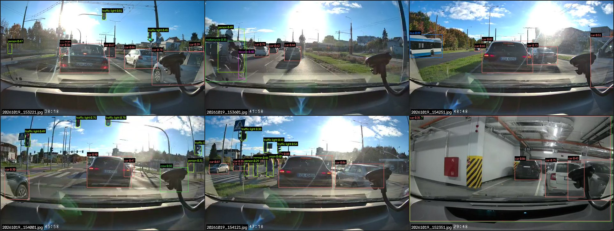
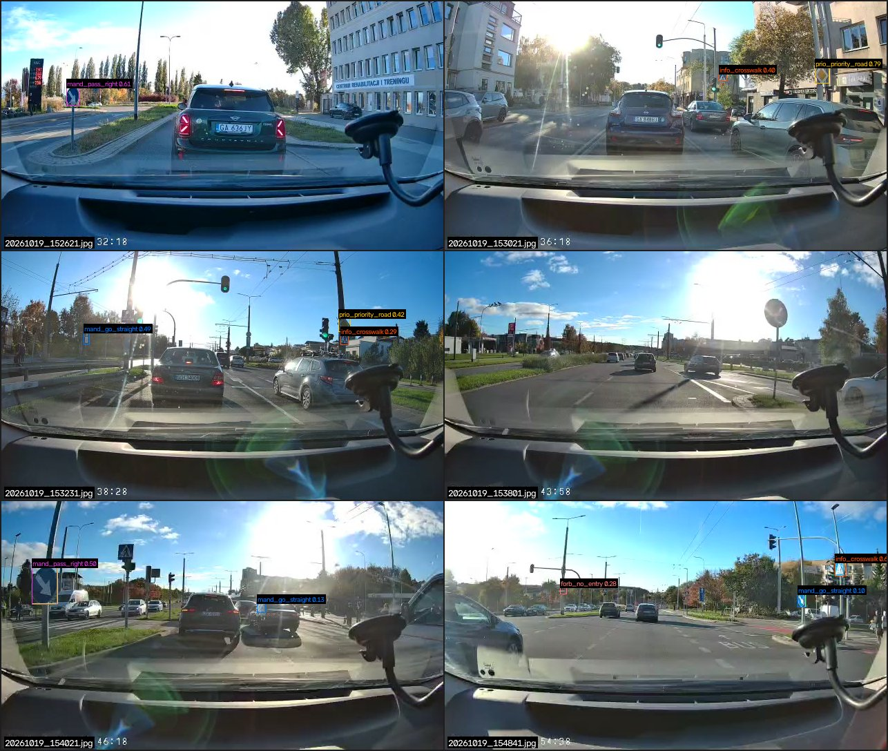
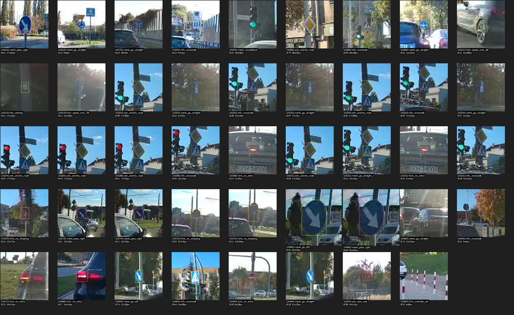

# Nano object detector on the 70mai dashcam: experiment 2026-10-19

This is the first measurement for the detector slot (VISION_ROADMAP.md §4.2). Two pretrained nano
YOLO models ran over the 174 frames of the drive home through Gdańsk on 2026-10-19. The drive
was a sunny afternoon, often with the sun in the picture. The frames are 640×360 JPEGs from the
live RTSP stream, sampled every 10 s from 15:22 to 15:57 CEST.
Source: `cyberpunk-prius-gateway/captures/2026-10-19/70mai/drive_home/`.

Nothing here ran on the phone, which was not connected. The timings were measured on the
laptop. The phone figures in §4 are estimates scaled from published benchmarks, and §4 says how.

## 1. Setup

| Item | Value |
|---|---|
| Laptop | i7-8850H (6C/12T, 4.3 GHz turbo), Quadro P3200 Max-Q 6 GB (Pascal, sm_61), Intel UHD 630 |
| Experiment venv | `.venv-vision/` (git-ignored by `.venv-*/`), Python 3.14, see `tools/vision/requirements-vision.txt` |
| Main packages | ultralytics 8.4.182, torch 2.13.0, onnxruntime 1.31, ai-edge-litert 2.2, ncnn 1.0.20260526 |
| Models + exports | `.venv-vision/models/` (not in git) |
| COCO model | `yolo11n.pt` (Ultralytics release v8.4.0, 5.4 MB), conf 0.25, NMS IoU 0.45 |
| Sign model | `AlessandroFerrante/StreetSignSenseY12n` on Hugging Face: YOLO12n, 63 classes (prio/forb/info/warn/mand), CC-BY-4.0, 5.6 MB, conf 0.10 recorded (0.25 used for counts) |
| Scripts | `tools/vision/yolo_detect.py` (JSON-lines detector, batch or `--stdin` server), `yolo_bench.py` (timing), `contact_sheet.py` (sheets) |
| Per-frame results | `docs/data/vision_detector_2026-10-19/*.jsonl` (one line per frame: class, score, box in px) |

The backend never imports anything from the venv. `cyberpunk_computer.vision.detectors` starts
`yolo_detect.py --stdin` as a child process and parses its JSON lines (§6).

## 2. What the COCO nano model sees (yolo11n, 640 input)

The counts are at score ≥ 0.25. "Filtered" drops two kinds of box. The first is a box centred on
the phone mount (`DASHCAM_MOUNT_REGION` = x 495–640, y 155–310). The second is a box covering more
than 30 % of the frame.

| Class | Boxes (raw) | Boxes (filtered) | Frames with ≥ 1 (filtered) | Notes |
|---|---:|---:|---:|---|
| car | 653 | 576 | 157 / 174 | Very good. Every car ahead and in the adjacent lanes is found, including cars queued 30–50 m away. 18 raw boxes are the whole bonnet or dashboard taken for a "car". |
| traffic light | 66 | 66 | 30 | Good at 640, even against the sun (15:32–15:33, 15:40–15:41). Only half survive at 416 (35). |
| person | 45 | 15 | 13 | 30 of the 45 are the **phone mount**. Real hits include pedestrians on the crossing at 15:41:21 and the scooter rider at 15:36:01. |
| truck | 18 | 17 | 14 | Vans and pickups, mostly right. |
| bicycle / motorcycle | 7 / 2 | 2 / 1 | — | Mostly the mount again. The real one is the scooter at 15:36:01. |
| bus | 1 | 1 | 1 | Trolleybus at 15:42:51 (0.89). |
| stop sign | 1 | 1 | 1 | **False:** a blue "keep right" sign (C-9) at 15:26:21, 0.65. |
| cow / dog / bird / umbrella | 13 / 5 / 2 / 1 | 0 | 0 | All of them are the phone mount. |
| boat | 3 | 0 | 0 | The whole bonnet seen at the car-park exit barrier. |



*Top row: 15:32:21 cars and traffic lights against the sun; 15:36:01 scooter rider (person +
motorcycle + a spurious bicycle); 15:42:51 trolleybus. Bottom row: 15:40:01 "cow 0.55" is the
phone mount; 15:41:21 pedestrians on the crossing, with the mount as "person"; 15:23:51
underground garage, where the whole frame is taken for a "car 0.35" and a "truck".*

**Systematic false positives.** These matter more than the misses.

1. **The suction-cup phone mount** sits in the right third of every frame. It is detected in
   50 of the 174 frames (29 %) as person, cow, dog, bicycle or bird, at scores up to 0.55. A fixed
   ignore region fixes this cheaply (`filter_detections(..., ignore_regions=[DASHCAM_MOUNT_REGION])`).
   The cost is that it also drops 59 car boxes centred there, most of them real cars in the right
   lane partly hidden behind the mount. A tighter polygon mask, or moving the mount, would be better.
2. **The own bonnet and dashboard** show up as one huge box ("car", "truck", "boat", 0.25–0.45)
   in 21 frames, mostly in the garage and at slow speed. `max_area_frac=0.3` removes them.
3. Reflections of the dashboard in the windscreen were sometimes taken for a "person" at the
   bottom edge (15:41:41, 15:42:21, 15:42:31).

**Misses.** Distant cars smaller than about 12 px are dropped at 416, and occasionally at 640.
I found no missed car closer than about 20 m on the sheets. At 416, 12 % of the
cars and traffic lights that score ≥ 0.5 at 640 are lost, and traffic lights fall from 66 to 35.
**Small objects need the 640 input.**

## 3. Traffic signs (StreetSignSense YOLO12n, 640 input)

At score ≥ 0.25 the sign model fired 21 times in 16 frames. Judged by eye on the enlarged crops:

| Verdict | Count | Examples |
|---|---:|---|
| Correct | 13 | priority road (D-1) at 15:30:21 (0.79) and 15:32:21–15:33:11 (0.29–0.63, stopped at a red light); pedestrian crossing (D-6) at 15:30:21, 15:32:31, 15:33:01, 15:48:41 (0.29–0.64); keep right (C-9) at 15:26:21 (0.61) and 15:40:21 (0.50) |
| Right object, wrong class | 2 | the same C-9 at 15:40:21 also as `mand_go_left` 0.56; a blue square sign at 15:30:51 as `mand_go_straight` |
| False positive | 5 | a green traffic light as `mand_roundabout`, a thin pole as `mand_go_straight` (2×), a red tail light as `forb_no_entry`, autumn leaves as `prio_give_way` |
| Unclear | 1 | 15:48:41 blue arrow sign `mand_go_left` 0.76 (too small to tell the arrow) |

Below 0.25 (0.10–0.25) almost everything is noise. Tail lights become "no entry", red-white
bollards become "no overtaking", and haze on a pole becomes "40" or "70". Those are the only
speed-limit outputs in the whole drive, and both are wrong.

The correct detections come from about **five distinct sign installations**. The model detected
no speed-limit sign. The sampled frames contain none seen from the front, as far as I could tell
from the overview sheets: 15:43:51 shows a round sign from behind. So **reading speed limits is
not tested by this drive.** The model also has no class for the large blue lane-direction signs
(15:27:01, 15:48:21) or for built-up-area signs. It misses them, as expected.



*Sign model output at score ≥ 0.10 on six frames: keep right; priority road + crossing; the
same pair at a red light; a round sign from behind (nothing detected, correctly); keep right
detected twice with conflicting classes; crossing + a tail light called "no entry".*



*Every sign-model box at score ≥ 0.10, enlarged 3×, with score and box size in source pixels.*

## 4. Timing

All numbers are medians over the 174 frames after 5 warm-up frames. **inf** is Ultralytics'
inference stage alone. **wall** is one `predict()` call: JPEG decode, letterbox, inference and NMS.
"1 core" means the process is pinned to one CPU. `torch.set_num_threads(1)` alone was *not*
honoured: it ran at full multi-thread speed, so the scripts pin with `sched_setaffinity`.
"default" is the library's own thread count on 12 logical CPUs.

**PyTorch `.pt`.** Ultralytics uses a rectangular letterbox here: 640×384 at 640 input,
416×256 at 416 input.

| Model | Input | 1 core inf / wall | 4 cores inf / wall | default inf / wall |
|---|---|---:|---:|---:|
| yolo11n.pt | 640 | 92 / 97 ms | 49 / 52 ms | 32 / 36 ms |
| yolo11n.pt | 416 | 54 / 57 ms | 29 / 33 ms | 19 / 22 ms |
| StreetSignSense YOLO12n.pt | 640 | 120 / 125 ms | — | 39 / 42 ms |
| StreetSignSense YOLO12n.pt | 416 | 66 / 69 ms | — | 22 / 24 ms |

**Exported yolo11n.** These use a fixed square input of 416×416 (or 640×640) and run through
the Ultralytics backends.

| Runtime | Input | 1 core inf / wall | 4 cores inf / wall | default inf / wall |
|---|---|---:|---:|---:|
| ONNX Runtime (CPU EP) | 416 | 18 / 23 ms ¹ | 14 / 19 ms | 21 / 52 ms ² |
| LiteRT fp32 (XNNPACK) | 416 | 55 / 59 ms | 15 / 19 ms | 18 / 21 ms |
| LiteRT int8 (XNNPACK) | 416 | 49 / 53 ms | 15 / 19 ms | 20 / 24 ms |
| ncnn CPU | 416 | 73 / 78 ms | 37 / 41 ms | 21 / 25 ms |
| ncnn CPU | 640 | — | — | 52 / 57 ms |
| **ncnn Vulkan, Quadro P3200** | 416 | — | — | **6.7 / 9.4 ms** |
| **ncnn Vulkan, Quadro P3200** | 640 | — | — | **12.0 / 16.0 ms** |
| ncnn Vulkan, Intel UHD 630 | 416 | — | — | 58 / 60 ms |
| ncnn Vulkan, Intel UHD 630 | 640 | — | — | 95 / 98 ms |

¹ Measured with `taskset -c 3`. With in-process affinity alone it showed 13 ms, so ONNX
Runtime's thread pool does not fully respect the pin. ² Thread oversubscription: preprocessing
alone took 22 ms.

**GPU through PyTorch/CUDA is not possible on this laptop.** Current torch CUDA wheels
(2.13.0+cu130) ship kernels for sm_75 and newer only. The P3200 is sm_61 and fails with
`cudaErrorNoKernelImageForDevice`. The older cu126 stack would bring Pascal back, but it costs
about 2.5 GB of downloads. The Quadro was therefore measured through **ncnn's Vulkan backend**,
which also runs on Adreno. Its detections are identical to the fp32 TFLite model: all 349 boxes
with score ≥ 0.5 recovered.

**Phone estimate (Snapdragon 845, not measured).** ncnn's published `benchncnn` table
(github.com/Tencent/ncnn, `benchmark/README.md`, read 2026-10-19) has no SD845 entry. It does
have the SD845's neighbours: the older SD835 and the newer SD855+. It also has a MacBook Pro 2019
with a Coffee Lake i7 (i7-9750H, 2.6 GHz six-core), whose single-core speed is close to this
laptop's.

1. On that i7, one thread runs `mobilenetv2_yolov3` in 64.9 ms. Our yolo11n@416 under ncnn runs
   in 73 ms on one laptop core. So yolo11n@416 ≈ 1.1× `mobilenetv2_yolov3`.
2. Published `mobilenetv2_yolov3` timings:
   - SD835: 99 ms on 4 threads, 58.7 ms on the Adreno 540 (Vulkan).
   - SD855+: 18.1 ms on 4 threads, 31.6 ms on the Adreno 640.
3. Scaled by 1.1×, yolo11n@416 would take about 110 / 65 ms (CPU / GPU) on an SD835 and about
   20 / 35 ms on an SD855+.
4. **On the SD845 (4× Kryo 385 Gold, Adreno 630), expect about 40–110 ms per frame on the big
   cores and about 35–65 ms on the GPU, i.e. roughly 10–25 fps.** At 416 that is comfortably above the
   2–5 fps budget. At 640 input (about 2.3× the cost of 416) the pessimistic end is about 4 fps.

The table entries come from different ncnn versions and say nothing about sustained thermal
throttling, so treat the estimate as ±2×. It has to be measured on the Poco.

## 5. Export

All exports are of `yolo11n.pt`. Export ran with `YOLO_AUTOINSTALL=false` after the incident in
the note below the table.

| Format | Input | Result | Size | Agreement with the exported fp32 model |
|---|---|---|---:|---|
| ONNX (opset 18, onnxslim) | 416×416 | success | 10.6 MB | reference: same boxes as LiteRT fp32 |
| TFLite / LiteRT fp32 | 416×416 | success | 10.7 MB | identical to ONNX |
| TFLite / LiteRT **fp16** | — | **not offered**: Ultralytics 8.4.83+ replaced `tflite` with `litert`, which accepts quantize = 32, 8, w8a16 or w8a32 but not 16 | — | — |
| TFLite / LiteRT **int8** (calibrated on the 174 frames) | 416×416 | success | 3.1 MB | cars and lights ≥ 0.5 vs `.pt`@416: 339/340 (fp32: 340/340); **traffic lights at ≥ 0.25: 33 → 20** |
| ncnn (pnnx) | 416 and 640 | success | 10.1 / 10.2 MB (fp32 file; fp16 storage at runtime) | Vulkan output = fp32 TFLite |

Note: the first LiteRT export let Ultralytics auto-install `litert-torch`. That package pins
torch < 2.14, so pip replaced the CPU torch with the **CUDA 13 torch from PyPI plus its nvidia-*
wheels**. This was an unplanned download of about 2.5–3 GB over the phone tether (the pip cache
is now 2.6 GB). The scripts now set `YOLO_AUTOINSTALL=false`, and the requirements file says to
use the CPU index. The venv still holds the CUDA build (6.6 GB on disk), which works on the CPU.

Also note that int8 cost the small objects most (traffic lights −40 %). On the phone, fp16 on the
GPU delegate (LiteRT converts fp32 weights to fp16 itself) or ncnn Vulkan with fp16 storage is the
better first try. Use int8 only on the CPU path, and only after checking small-object recall.

## 6. The detector slot (`cyberpunk_computer/vision/detectors/`)

- `Detection(cls, score, box=(x0, y0, x1, y1) px, t)` is frozen, with width, height, area, center
  and dict round-trip. `Detector` is a protocol with `process(frame_path, t) -> list[Detection]`.
  A detector never raises.
- `NullDetector` is the default.
- `SubprocessDetector(cmd)` runs a long-lived helper over a JSON-lines protocol. The helper
  prints a `{"ready": true}` banner, then answers one frame path with one line. It is started
  lazily. When it stalls or dies it is killed, the frame returns `[]`, and the helper restarts
  after a back-off. `SubprocessYoloDetector` wires this to `.venv-vision` and
  `tools/vision/yolo_detect.py`. It works today for offline evaluation: a model start takes
  about 1–2 s, then about 25 ms per frame on CPU.
- `filter_detections()` filters by score, class, ignore region (the mount) and maximum box area.
- `TfliteDetector` is a stub that raises `NotImplementedError`. The LiteRT Python API needs
  numpy, which the backend does not have. The intended on-car path is therefore a **native helper
  binary that speaks the same JSON-lines protocol**: LiteRT C++ with the GPU delegate, or ncnn
  with Vulkan, built for Android/arm64. `SubprocessDetector` then works unchanged. The class
  docstring also keeps the in-process numpy path, as a commented sketch.
- Tests in `tests/test_vision_detectors.py` cover the dataclasses, parsing of recorded output
  (fixture `tests/fixtures/yolo_detect_2026-10-19_sample.jsonl`), filtering, and the protocol
  against a fake helper (stall, die, silent, missing binary). One end-to-end test on a real frame
  is skipped when the venv or model is absent.

## 7. Verdict: signs at 640×360

- **Shape and colour classes work close up.** A sign reaches about **17–25 px** only when the car
  is nearly level with it. At that size the model gets the priority-road diamond, the crossing
  square and the keep-right disc right at 0.3–0.8. Below about 12 px the output is noise.
- **Digits are not readable at this resolution in practice.** At 20 px a speed-limit disc has a
  roughly 10 px inner field, which leaves 3–4 px per digit. The model never produced a speed-limit
  class that was correct. A guess at distance, assuming the usual 70mai wide lens (about 120–130°
  horizontal, roughly 170–250 px focal length): a 60 cm sign is 20 px at only **about 5–8 m**, and
  10 px at 10–15 m. VISION_ROADMAP §4.2 says a 60 cm sign is readable from 15–20 m at 640×360.
  That is optimistic by about 2–3× for this lens and stream. The 1080p recording, or a narrower
  camera, would roughly double the range.
- **The 10 s sampling misses most signs.** A sign is in the readable zone for well under a second
  at 50 km/h. Only the red-light stop at 15:32–15:33 gave the same sign in six frames. Phase B needs
  the 2–5 fps grabber feed, plus tracking across frames.
- **The sign model is a usable placeholder, not the answer.** Its classes cover the Polish signs
  that matter (speed limits 5–130, no entry, give way, stop, priority road). It confuses the
  blue mandatory-direction discs with each other and has no class for built-up-area or
  lane-direction signs. Fine-tuning on Polish data (Mapillary, then our own frames) remains the
  plan in the roadmap.
- **The COCO nano model is good enough today** for cars, traffic lights and larger road users at
  640 input. It needs the mount mask and the large-box filter. Run at the 2–5 fps the slot needs, it should
  take only a fraction of the phone's CPU or GPU (estimate from §4).

## 8. Reproduce

```sh
python3 -m venv .venv-vision
.venv-vision/bin/pip install -r tools/vision/requirements-vision.txt \
    --extra-index-url https://download.pytorch.org/whl/cpu
F=../cyberpunk-prius-gateway/captures/2026-10-19/70mai/drive_home
.venv-vision/bin/python -I tools/vision/yolo_detect.py --model .venv-vision/models/yolo11n.pt \
    --imgsz 640 $F > coco.jsonl
.venv-vision/bin/python -I tools/vision/yolo_bench.py --model .venv-vision/models/yolo11n.pt \
    --imgsz 416 --threads 1 $F
.venv-vision/bin/python -I tools/vision/contact_sheet.py crops signs.jsonl --min-score 0.1 -o crops.jpg
```
