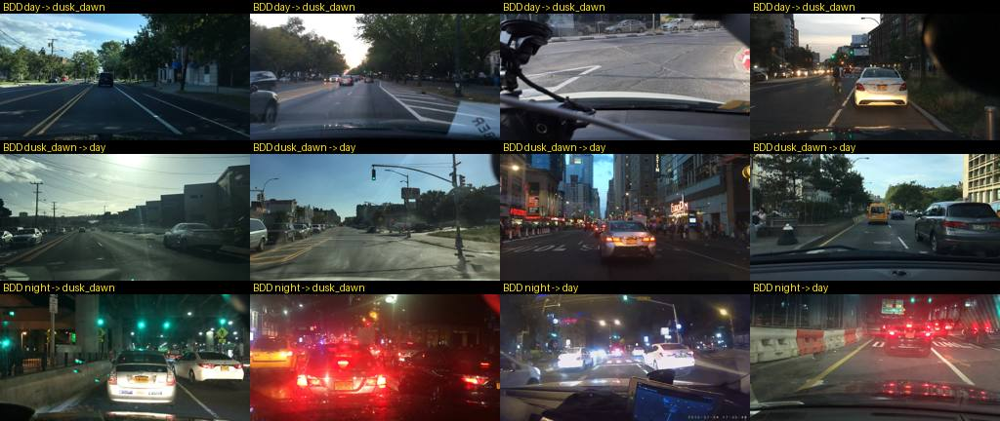
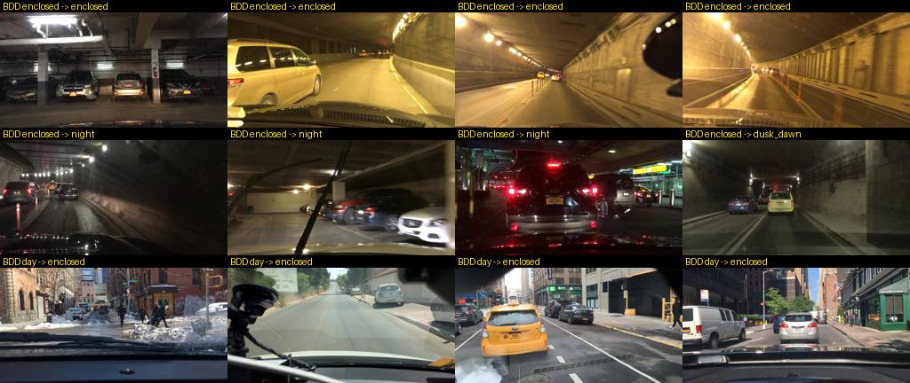
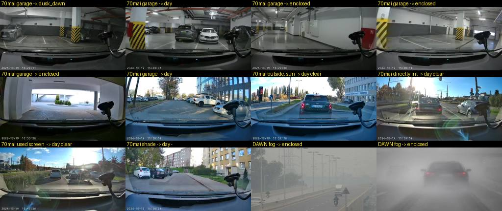

# Dashcam environment model (2026-10-19)

Goal: classify the 70mai stream (1 fps, 640×360) as **day / dusk-dawn / night / enclosed**
plus a weather hint, from image statistics only, with an ML-free runtime (pure Python +
ffprobe). Fitted and checked on public dashcam data and on our own drive. Code:
`cyberpunk_computer/vision/scene_features.py`, `environment.py`, the environment mode
of `auto_lights.py`; fitting tools in `tools/vision/` (experiment venv only).

## 1. Data

| Set | What was downloaded | Labels used | Licence | Where |
|---|---|---|---|---|
| **BDD100K val** (Berkeley DeepDrive) | all 10 000 val images (1280×720 dashcam frames, US cities), 642 MB | `timeofday` (daytime 5258, night 3929, dawn/dusk 778, undefined 35), `weather` (clear 5346, overcast 1239, undefined 1157, snowy 769, rainy 738, partly cloudy 738, foggy 13), `scene` (tunnel 27, parking lot 49, gas station 7, …) | BDD100K licence (BSD-style; educational, research and not-for-profit use; the mirror tags it "bsd"). Downloading means agreeing to it. | `/home/piotr/datasets/dashcam/bdd100k_val_fo/` (`data/*.jpg`, `samples.json`, `labels.csv`) |
| **DAWN** (Kenk & Hassaballah, Mendeley 10.17632/766ygrbt8y.3) | Fog 300, Rain 200, Snow 204 images (web images of mixed size), 104 MB zipped | folder = weather | CC BY-NC 3.0 | `/home/piotr/datasets/dashcam/dawn/` |
| **Our drive** 2026-10-19 | 174 frames, 10 s apart (`cyberpunk-prius-gateway/captures/2026-10-19/70mai/drive_home/`) | `annotations.txt`: garage before 15:25:08 CEST, then sunny / into the sun / sun in frame / after wipers / shade | own | — |

How the BDD data was obtained without an account: the labels and images come from the
public FiftyOne export **`dgural/bdd100k`** on Hugging Face (val split, labels in
`samples.json`). After ~4 750 single-file downloads Hugging Face rate-limited the IP
(HTTP 429, no token on this machine); the remaining 3 927 images were taken from the
public zip **`hirundo-io/bdd100k-val`** (same val images; 200 overlapping files checked
byte-identical by MD5). The DAWN zips come from the public mirror `qninhdt/dawn` (the
Mendeley page itself lists no downloadable files without a login). Nothing larger was
needed: total on disk 866 MB. Other sets considered: ACDC and the full BDD100K need
an account; Waymo / nuScenes are far too large for this question.

Hand labels: BDD's `scene=tunnel` also tags tunnel *entrances seen from outside* and
streets near tunnels, and covered car parks hide under `parking lot`. All 27 tunnel, 49
parking-lot and 7 gas-station frames were looked at; 27 frames are really enclosed (22
tunnel interiors, 5 covered / multi-storey car parks), 4 "tunnel" frames are outdoors
and 1 (a road under a bridge deck) is ambiguous and excluded:
`tools/vision/bdd_val_enclosed_labels.csv`.

## 2. Features (`scene_features.extract`, one ffprobe run per frame)

Every frame is scaled to 640×360 first (no-op for the 70mai). Bands: sky = top third,
road = bottom half, b0…b4 = five horizontal fifths, left / right halves of the sky band.

| Feature | Meaning |
|---|---|
| `sky_y`, `sky_u`, `sky_v`, `sky_chroma` | as in `light_features` |
| `sky_low`, `sky_high`; `y_low`, `y_high` | signalstats 10 % / 90 % luma percentiles of the sky band / whole frame |
| `sky_sat`, `sat`, `road_sat` | mean saturation |
| `b0_y … b4_y`, `sky_l_y`, `sky_r_y`, `road_*` | coarse vertical / left-right profile |
| `sky_clip`, `full_clip` | share of pixels with Y > 250 |
| `sky_dark`, `full_dark` | share of pixels with Y < 24 |
| `edge_full`, `edge_sky` | `edgedetect` pixel share (texture) |
| derived: `sky_blue` = (U − V)/2, `top_drop` = b0 − b1, `top_mid` = b0 − b2, `sky_spread` | blue sky > 0, sodium / warm lamps < 0; bright sky above the horizon |

Cost: ≈ 90 ms per 640×360 frame on the laptop (one ffprobe process; ~40 ms of it is
process start). Pruning to the 9 branches the model reads saves only ~15 ms, so the
full set stays (it is what the fits and future refits use). Cached features:
`/home/piotr/datasets/dashcam/features/{bdd_val,dawn,drive_home_2026-10-19}.csv`
(`tools/vision/env_features.py`).

## 3. Fitting

`tools/vision/env_fit.py` (scikit-learn 1.9.1, seeded). Held-out = stratified 30 % of
BDD val. The 70mai drive was used as an **out-of-domain check during model selection**
(feature sets whose trees called the sunny drive "dusk" were rejected, e.g. any tree
using the road band, whose bottom is the hood in BDD and the dashboard in the 70mai),
so it is not an untouched test set.

### 3.1 Time of day: decision tree, depth 3, 8 features

`DecisionTreeClassifier(max_depth=3, min_samples_leaf=40, class_weight="balanced")` on
`sky_y, sky_high, sky_low, sky_dark, sky_blue, y_high, full_dark, edge_full`.

Held-out BDD val (n = 2990), accuracy **0.874** (5-fold CV 0.861–0.876):

| true \ predicted | day | dusk_dawn | night | recall |
|---|---|---|---|---|
| day | 1366 | 184 | 28 | 0.87 |
| dusk_dawn | 98 | 120 | 15 | 0.52 |
| night | 20 | 32 | 1127 | 0.96 |
| precision | 0.92 | 0.36 | 0.96 | |

Day vs dusk is the weak part, and partly label noise: many BDD "dawn/dusk" frames look
like a bright afternoon and many "daytime" frames have a low sun (see the sheet below).
In the car the **sun elevation** is a prior on this split (§4), which BDD cannot test
(the export has no timestamps / GPS).

### 3.2 Enclosed: one conjunction (grid search)

A tree on 27 positives overfits (5-fold CV recall 0.07–0.48 in the trials, the higher
values only with 2–8 % false positives), and BDD tunnels (sodium-lit, orange) look different from our LED-lit garage, so
a 4-threshold conjunction was grid-searched on BDD enclosed + our 11 garage-interior
frames against BDD outdoor frames and our sunny drive:

**enclosed = `sky_y > 60` and `top_drop ≤ 10` and `sky_high ≤ 200` and `sky_blue ≤ 2`**
(lit, no bright sky above the horizon, no blue).

| group (per frame) | flagged enclosed |
|---|---|
| BDD enclosed (27) | 0.56 (15) |
| our garage, inside (11) | 0.82 (9) |
| our outdoor (161) | 0 |
| BDD daytime / dusk / night, not enclosed | 0.028 / 0.022 / 0.026 |

For the *lights* decision the misses mostly do not matter: of the 27 enclosed BDD
frames 26 still get lights (11 more are called night or dusk_dawn).

### 3.3 Weather: what the statistics support

A depth-4 tree on 12 weather features (daytime BDD, clear / overcast / rainy / snowy)
reaches accuracy 0.49, precision clear 0.83 / overcast 0.44 / rainy 0.30 / snowy 0.17.
**Rain, snow and fog are not separable from frame statistics** (BDD "snowy" mostly
means snow on the ground under a blue sky; rain shows as wet roads and drops that a
band average does not see). Only two calls are published, both daytime only:

| call | rule | precision | recall | 70mai sunny drive |
|---|---|---|---|---|
| `clear` (blue sky visible) | `sky_blue > 8` and `sky_sat > 15` | 0.82 (vs clear + partly cloudy) | 0.60 | 81 % of outdoor frames |
| `overcast` (bright grey sky: overcast / rain / snow / fog) | `sky_blue ≤ 1`, `sky_high ≥ 200`, `sky_sat ≤ 8` | 0.90 | 0.32 | 1 % (2 frames) |
| otherwise | `None` (no call) | | | |

On DAWN (fog / rain / snow, other cameras) 20 % of the frames get `overcast`, 6 %
`clear`, the rest no call.

## 4. The rule set in plain words (`vision/environment.py`)

Per frame:

1. **Night** when the sky band is dark (`sky_y ≤ 56`); a dark sky band that is still
   blue (`sky_blue > 5.4`) is dusk/dawn.
2. Otherwise **dusk/dawn** when the frame is low-texture (`edge_full ≤ 0.038`) and has
   ≥ 5 % dark pixels; **day** for textured frames (the strongest day leaf: edge share
   > 0.051). The two middle "day" leaves are weak (p ≈ 0.51 / 0.58).
3. **Enclosed** when the sky band is lit, nothing above the horizon is brighter than
   the band below it, the sky band's 90 % percentile stays ≤ 200 and it is not blue.
4. **Weather** (only for day, not enclosed): `clear` for a saturated blue sky,
   `overcast` for a bright, grey, unsaturated sky, else no call.

Then (car runtime, `EnvironmentModel.update`): the per-frame class probabilities are
averaged over **10 s** (10 frames at 1 fps) and the label is the argmax; enclosed needs
> 50 % of the window's votes, a weather call ≥ 60 %. The **sun elevation** (GPS or
`BACKEND_HOME_LATLON`) scales the time-of-day probabilities: below −6° "day" × 0.05,
above +10° "night" × 0.05 and "dusk_dawn" × 0.2.

Lights (`AutoLightModel`, environment mode): ON candidate = night, dusk_dawn or
enclosed; OFF candidate = day; an environment with confidence < 0.6 is the dead band
(hold). Unchanged: sun below −6° → ON at once; the clipped-sky rule; 30 s medians,
5 s to switch ON, 20 s to switch OFF; first decision bootstraps at once.

## 5. Metrics of the shipped model

Runtime model (trees refit on all labelled BDD val, so these include the fit data),
per frame, no sun prior:

| | day | dusk_dawn | night |
|---|---|---|---|
| recall (BDD val, n = 9965) | 0.88 | 0.48 | 0.93 |
| precision | 0.91 | 0.34 | 0.98 |

**Lights ON (= night | dusk | enclosed) vs BDD truth, per frame, n = 9988:**

| | accuracy | ON recall | ON precision | ON share in BDD day / dusk / night / enclosed |
|---|---|---|---|---|
| old `LightThresholds` (120/150, chroma 8/12) | 0.786 | 0.846 | 0.739 | 0.27 / 0.27 / 0.96 / 0.52 |
| **environment** | **0.881** | **0.909** | **0.851** | 0.14 / 0.52 / 0.99 / 0.96 |

The 14 % of BDD daytime frames that would get lights are mostly the day → dusk
confusion; in the car the +10° sun prior removes most of those and the 30 s median /
5 s persistence removes single frames. Night and enclosed: 99 % / 96 %.

**Old thresholds (task 3a).** Swept `sky_y_on/off` with chroma 8/12 fixed: 100/130 →
BDD 0.818, 110/140 → 0.801, 120/150 → 0.786, 130/160 → 0.777; lowering them helps BDD
a little but loses garage frames on our drive (garage ON 0.69 at 100/130 vs 0.77). BDD's
exposure is not the 70mai's (BDD daytime sky median Y 130 and chroma 8; 70mai 183 and
27), so **the thresholds were left at 120/150, 8/12**; they are now only the fallback
when no environment is available.

**Our drive (174 frames, 10 s apart; with 10 s spacing the window holds one frame):**

| segment | frames | label |
|---|---|---|
| garage, lights on (before 15:25:08 CEST) | 13 | enclosed 9, dusk_dawn 1, day 3 (one inside frame at 15:22:34 with a bright ceiling, and the two exit-ramp frames 15:24:51 / 15:25:01 which already face daylight) |
| outside, sunny / into the sun / sun in frame / after wipers / shade | 161 | **day 161**; weather clear 130, no call 29, overcast 2 |

Lights replay (environment mode, sun from Gdańsk): ON from the first garage frame,
**OFF at 15:25:11 CEST** (3 s after the driver's "outside" note; the old rule: 15:25:21),
then no switch for the rest of the drive. Same result with `--no-sun`.

## 6. Failure modes

Time of day (BDD, "truth → model"): low-sun afternoons called dusk; bright "dusk"
frames that look like day (label noise); night scenes full of street lights, headlamps
or a lit underpass called dusk or day (the AE exposes for the lights).

Enclosed: caught = lit garages and sodium tunnels; missed = dark tunnels / car parks
(they become night or dusk, so lights are still on); false "enclosed" in daylight =
streets in deep building shade with a grey sky band and nothing bright above.

Our drive: garage frames with bright ceiling lights read as day / dusk; the exit ramp
correctly flips to day. DAWN: dense fog is grey, flat and lit, i.e. it matches the
enclosed rule (72 of 300 fog frames). Lights on is the right action there, the label is
wrong.

Further limits: only US BDD cameras + one 70mai drive; no own dusk, night, rain, fog,
snow or tunnel frames yet; the 70mai's burned-in clock and phone holder sit in the frame
(they do not touch the sky band); `edge_full` depends on lens sharpness and JPEG
quality, which differ per camera.

## 7. Runtime integration (2026-10-19)

* `scene_features.extract` replaces `light_features.extract` in `DashcamLightIngest`;
  `EnvironmentModel.update` → `AutoLightModel.update(..., environment=env)`.
* `VisionState` gained `environment`, `time_of_day`, `enclosed`, `weather`,
  `environment_confidence` (None until a frame was classified).
* Ingest interval default **1 s** (`BACKEND_DASHCAM_INTERVAL_S`). A session per frame
  cannot sustain 1 fps on the 70mai (setup ≈ 1 s, refusals right after a teardown), so
  the default source is now **`DashcamStreamSource`**: one long-running ffmpeg writing
  1 fps over `latest.jpg` atomically (`-update 1 -atomic_writing 1`), restarted with a
  back-off when it exits or stalls. `BACKEND_DASHCAM_SOURCE=grab` restores the old
  session-per-frame source. **Not yet run against the real camera.**
* Replay: `python -m cyberpunk_computer.vision.environment --frames DIR [--latlon …]`,
  `python -m cyberpunk_computer.vision.auto_lights --frames DIR | --features CSV`.
* Refit: `tools/vision/env_features.py` → `env_fit.py fit` → paste `TOD_TREE` into
  `environment.py` → `env_fit.py runtime` / `fixture` → `env_sheets.py --out docs/img`.

## 8. Own-drive samples that would help most

1. **Dusk and dawn with the sun between +10° and −6°** (several drives, both
   directions): the weakest class, and the sun prior's thresholds are guesses.
2. **Night in town and on unlit roads**, with headlamps on, to confirm the night rule
   on the 70mai's exposure (all night numbers so far are BDD's).
3. **Tunnels and other garages** (Gdańsk: Tunel pod Martwą Wisłą; multi-storey car
   parks), including entering and leaving, to replace the 11-frame garage evidence and
   check the 10 s window / 5 s ON timing.
4. **Overcast and rain by day**, with wipers on, to see whether the `overcast` rule and
   the "no call" default hold on the 70mai, and as the base for a temporal rain cue
   (wiper sweeps in frame-to-frame differences at 1 fps).
5. **Fog** (to measure how often it lands in "enclosed") and **low sun in winter**.

Record with `tools/dashcam_sampler.py` (session per frame, so a few seconds apart) or,
better, the backend's 1 fps stream source, and note the conditions with laptop time as
in `annotations.txt`.
